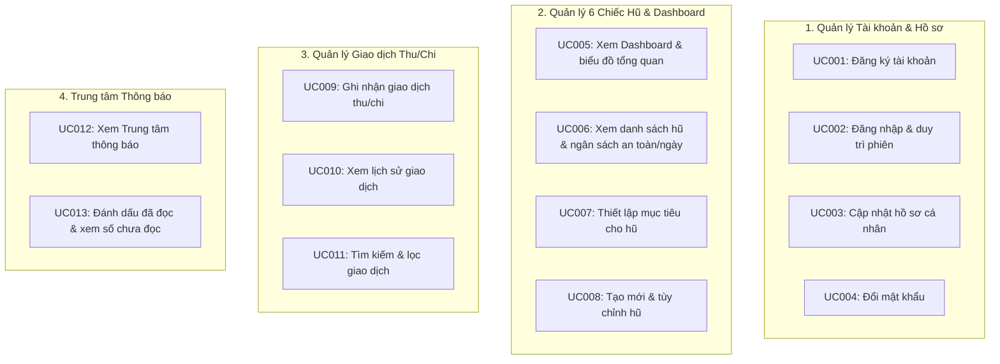

# OWLFIN - Personal Finance Management Application

> **Hệ thống Quản lý Tài chính Cá nhân Chuẩn mực theo Phương pháp 6 Chiếc Hũ (JARS System)**  
> *Ngôn ngữ thiết kế tối giản, hiện đại mang bản sắc Đại học Việt Nhật (VJU)*

[](https://dotnet.microsoft.com/)
[](https://react.dev/)
[](https://vitejs.dev/)
[](https://www.mysql.com/)
[](https://www.docker.com/)
[](https://swagger.io/)

---

## 1. Giới thiệu tổng quan (Overview)

**OWLFIN** là ứng dụng web quản lý tài chính cá nhân toàn diện, hỗ trợ người dùng xây dựng thói quen quản lý dòng tiền kỷ luật và khoa học thông qua **Quy tắc 6 Chiếc Hũ Tài Chính** (*JARS System của T. Harv Eker*). 

Hệ thống cung cấp trải nghiệm theo dõi tài sản thời gian thực, tự động hóa phân bổ các nguồn thu nhập theo tỷ lệ khoa học, tính toán ngân sách chi tiêu an toàn hàng ngày và chủ động phát cảnh báo khi người dùng vượt quá hạn mức an toàn.

Ứng dụng được thiết kế theo phong cách tối giản chuẩn **VJU Style** (sử dụng các gam màu chủ đạo Đỏ Bordeaux, Trắng, Xám ghi nhạt) mang lại sự trang nhã, hiện đại và tập trung tối đa vào dữ liệu tài chính của người dùng.

Target URL: https://personal-fintech-pink.vercel.app/

---

## 2. Phạm vi nghiệp vụ & 13 Use Cases cốt lõi (Core Scope)

Hệ thống được chuẩn hóa tập trung vào **13 Use Case chủ chốt** thuộc 4 phân hệ nghiệp vụ:



### Chi tiết các phân hệ:
1. **Phân hệ 1: Quản lý Tài khoản & Hồ sơ (Authentication & Profile)**
   * `UC001`: Đăng ký tài khoản mới với quy tắc bảo mật mật khẩu kết hợp chữ và số.
   * `UC002`: Đăng nhập hệ thống, cấp phát mã phiên an toàn JWT và duy trì trạng thái đăng nhập.
   * `UC003`: Cập nhật họ tên hiển thị trong hồ sơ người dùng.
   * `UC004`: Đổi mật khẩu tài khoản với cơ chế xác thực mật khẩu hiện tại.
2. **Phân hệ 2: Quản lý 6 Chiếc Hũ & Dashboard (6 Jars & Budgeting)**
   * `UC005`: Bảng điều khiển tài chính trực quan: tổng tài sản, thu nhập & chi tiêu trong tháng, biểu đồ cơ cấu hũ (Doughnut) và biểu đồ dòng tiền (Line Chart).
   * `UC006`: Quản lý 6 hũ mặc định (NEC 55%, FFA 10%, EDU 10%, LTSS 10%, PLAY 10%, GIVE 5%), tự động tính toán **Ngân sách chi tiêu an toàn mỗi ngày** theo số ngày còn lại trong tháng.
   * `UC007`: Thiết lập mục tiêu tiết kiệm tích lũy cho từng hũ và theo dõi thanh tiến độ phần trăm hoàn thành.
   * `UC008`: Tùy biến tỷ lệ phần trăm phân bổ, tạo thêm hũ chuyên biệt (tối đa 10 hũ/người) và xóa hũ khi cần.
3. **Phân hệ 3: Quản lý Giao dịch Thu/Chi (Transaction Management)**
   * `UC009`: Ghi nhận giao dịch đa năng:
     * **Thu nhập**: Tự động chia số tiền vào các hũ theo tỷ lệ phần trăm đã cấu hình.
     * **Chi tiêu**: Trừ trực tiếp số dư của hũ được chọn và kiểm tra cảnh báo hạn mức.
   * `UC010`: Tra cứu lịch sử biến động số dư theo thứ tự thời gian giảm dần, định dạng tiền tệ Việt Nam (`VND`).
   * `UC011`: Tìm kiếm giao dịch nhanh theo từ khóa mô tả và lọc theo phân loại (Tất cả / Thu nhập / Chi tiêu).
4. **Phân hệ 4: Trung tâm Thông báo (Notifications System)**
   * `UC012`: Hộp thư thông báo cập nhật các biến động quan trọng: cảnh báo chi tiêu vượt ngưỡng, chúc mừng đạt mục tiêu tích lũy.
   * `UC013`: Huy hiệu hiển thị số lượng thông báo chưa đọc trên Header; hỗ trợ đánh dấu đã đọc từng thông báo hoặc tất cả chỉ với một cú nhấp.

---

## 3. Kiến trúc hệ thống & Ngăn xếp công nghệ (Architecture & Tech Stack)

```
[ Frontend: React 19 + Vite ] <--- HTTP REST (JWT Bearer) ---> [ Backend: ASP.NET Core 9 Web API ]
          :3000                                                             :8080
                                                                              |
                                                                              v
                                                                   [ Database: MySQL 9.0 ]
                                                                            :3306
```

### Công nghệ sử dụng:
* **Frontend**:
  * React 19 (Hooks, Context, Functional Components)
  * Vite 7 (Build tool & Fast HMR Dev Server)
  * React Router 7 (Điều hướng trang SPA)
  * Bootstrap 5 & React-Bootstrap (Hệ thống lưới Responsive, UI Modals)
  * Chart.js & React-Chartjs-2 (Biểu đồ Doughnut và Line Chart trực quan)
  * FontAwesome 6 & React Icons (Bộ biểu tượng giao diện)
* **Backend**:
  * ASP.NET Core 9.0 Web API (C#)
  * Entity Framework Core 9 (Pomelo MySQL Provider, Code-First)
  * JWT Bearer Authentication (Bảo vệ các endpoints RESTful với Claims)
  * BCrypt.Net (Băm mật khẩu người dùng chuẩn mã hóa một chiều an toàn)
  * Swagger / OpenAPI 3.0 (Tài liệu hóa và thử nghiệm API)
* **Cơ sở dữ liệu & Hạ tầng**:
  * MySQL 9.0 (Docker Container)
  * Docker & Docker Compose (Quản lý môi trường triển khai)

---

## 4. Cấu trúc thư mục dự án (Project Structure)

```text
├── ClientReact/            # Ứng dụng Single Page Application (React 19 + Vite)
│   ├── src/
│   │   ├── components/     # Header, Sidebar, GlobalTransactionModal, JarModal
│   │   ├── pages/          # Dashboard, Jars, History, Settings, Login
│   │   └── assets/         # Logo VJU, Stylesheet (App.css, index.css)
│   ├── vite.config.js      # Cấu hình cổng 3000 và proxy /api sang backend
│   └── package.json
├── Server/                 # Dịch vụ Backend ASP.NET Core 9 Web API
│   ├── Controller/         # AuthController, JasController, TransactionController,
│   │                       # DashboardController, NotificationController
│   ├── Models/             # Entity Models (User, Jar, Transaction, Notification)
│   ├── Data/               # AppDbContext, Database Migrations
│   ├── DTOs/               # Data Transfer Objects cho request/response
│   ├── Properties/         # launchSettings.json (Port 8080)
│   └── Program.cs          # Cấu hình DI, Middleware, JWT, CORS, Routing
├── docker-compose.yml      # Cấu hình container dịch vụ MySQL 9.0
├── SYSTEM_SPECIFICATION.md # Tài liệu đặc tả hệ thống và thiết kế kỹ thuật chi tiết
├── USER_REQUIREMENTS_DOCUMENT.md # Tài liệu yêu cầu người dùng (URD)
└── README.md
```

---

## 5. Hướng dẫn cài đặt & Khởi chạy Local (Getting Started)

### Yêu cầu môi trường:
* [.NET 9.0 SDK](https://dotnet.microsoft.com/download/dotnet/9.0) (hoặc mới hơn)
* [Node.js 18+](https://nodejs.org/) & npm
* [Docker Desktop](https://www.docker.com/)

### Bước 1: Khởi động Cơ sở dữ liệu MySQL
```bash
docker compose up -d db
```
* **Cổng**: `localhost:3306`
* **Database**: `FinanceJarDb`
* **Tài khoản**: `root` / Mật khẩu: `0944138963Pt@`

### Bước 2: Khởi động Backend API (.NET)
```bash
cd Server
dotnet run --launch-profile http
```
* **API Service**: `http://localhost:8080`
* **Swagger UI Documentation**: [http://localhost:8080/swagger/index.html](http://localhost:8080/swagger/index.html)

### Bước 3: Khởi động Frontend Client (React)
Mở cửa sổ Terminal mới:
```bash
cd ClientReact
npm install
npm run dev
```
* **Ứng dụng Web**: [http://localhost:3000](http://localhost:3000) (tự động chuyển tiếp các yêu cầu `/api/*` tới cổng `8080`).

---

## 6. Quy tắc nghiệp vụ cốt lõi (Business Rules)

1. **Phương pháp 6 Chiếc Hũ mặc định**:
   * **Thiết yếu (NEC - 55%)**: Phục vụ các nhu cầu sinh hoạt cơ bản bắt buộc (ăn uống, thuê nhà, điện nước, xăng xe).
   * **Tự do tài chính (FFA - 10%)**: Tích lũy cho các kênh đầu tư sinh lời tạo nguồn thu nhập thụ động.
   * **Phát triển bản thân (EDU - 10%)**: Chi tiêu cho học tập, sách báo, các khóa đào tạo nâng cao kỹ năng.
   * **Tiết kiệm dài hạn (LTSS - 10%)**: Quỹ dự phòng khẩn cấp và các mục tiêu mua sắm tài sản lớn trong tương lai.
   * **Hưởng thụ (PLAY - 10%)**: Tự thưởng cho bản thân, giải trí, du lịch, chăm sóc tinh thần.
   * **Cho đi (GIVE - 5%)**: Từ thiện, giúp đỡ gia đình, bạn bè và đóng góp cho cộng đồng.
2. **Công thức tính ngân sách an toàn mỗi ngày**:
   $$\text{DailyBudget} = \frac{\text{Jar.Balance}}{\text{RemainingDaysInMonth}}$$
   *Giúp người dùng dễ dàng định lượng mức chi tiêu giới hạn của ngày hôm nay để không gây thâm hụt số dư cuối tháng.*
3. **Phân bổ thu nhập tự động**: Khi ghi nhận một khoản thu nhập mới, hệ thống tự động nhân số tiền đó với tỷ lệ % của từng hũ và cộng tương ứng vào số dư của các hũ hiện có.

---

## 7. Tài liệu tham chiếu (Documentation)

* 📄 [USER_REQUIREMENTS_DOCUMENT.md](USER_REQUIREMENTS_DOCUMENT.md): Đặc tả chân dung người dùng, bài toán kinh doanh, User Stories và quy trình nghiệp vụ chi tiết.
* 📄 [SYSTEM_SPECIFICATION.md](SYSTEM_SPECIFICATION.md): Thiết kế thực thể CSDL (ERD), sơ đồ luồng dữ liệu, chi tiết API RESTful và các quy tắc ràng buộc logic.
