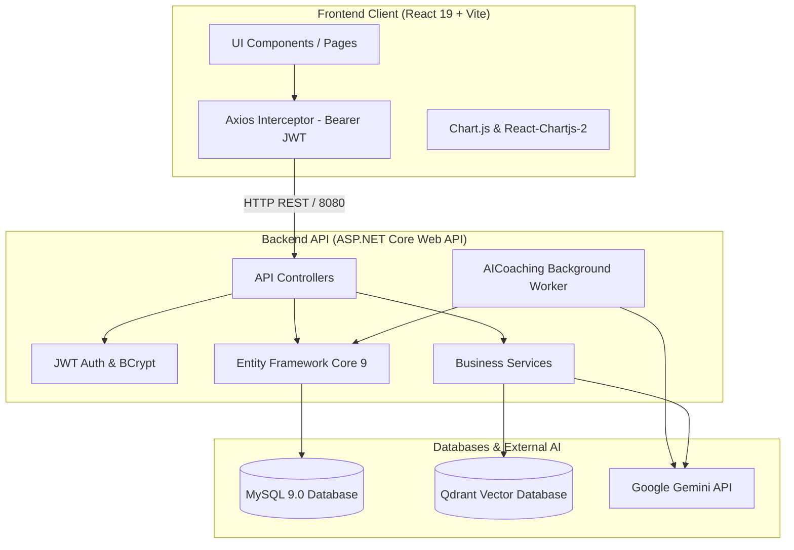
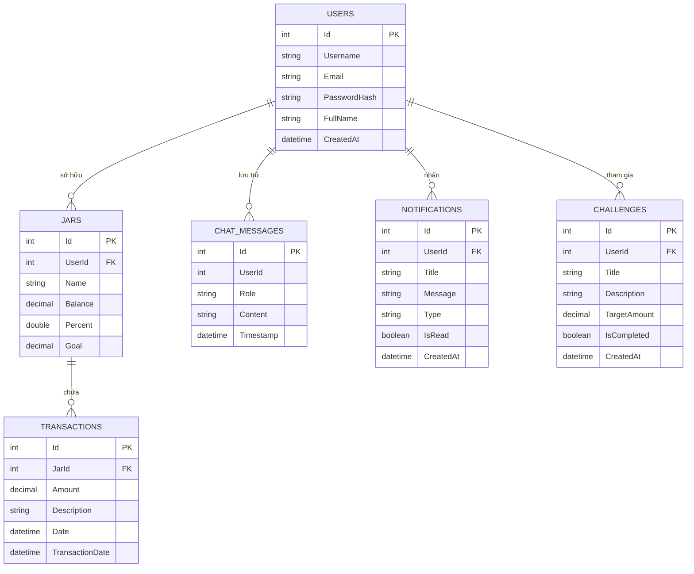
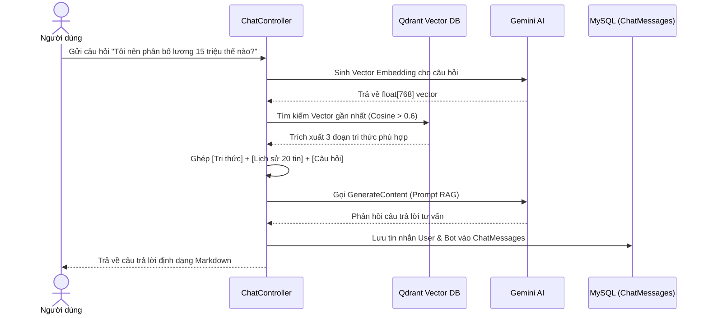

# TÀI LIỆU ĐẶC TẢ HỆ THỐNG QUẢN LÝ TÀI CHÍNH CÁ NHÂN THÔNG MINH
## (FinanceJar - AI-Powered Personal Finance Management Application)

---

## 1. TỔNG QUAN HỆ THỐNG VÀ KIẾN TRÚC KỸ THUẬT

### 1.1. Giới thiệu dự án
**FinanceJar** là ứng dụng quản lý tài chính cá nhân thông minh kết hợp phương pháp **6 Chiếc Hũ Tài Chính** (Jars System của T. Harv Eker) với công nghệ **Trí Tuệ Nhân Tạo (Generative AI)**, cơ chế tìm kiếm ngữ nghĩa tăng cường **RAG (Retrieval-Augmented Generation)**, và thị giác máy tính **Multimodal Vision OCR**.

Hệ thống hỗ trợ người dùng tự động phân bổ thu nhập, ghi nhận chi tiêu theo thời gian thực, đọc hóa đơn tự động từ ảnh chụp, hỏi đáp tài chính chuyên sâu với chatbot AI được nạp tri thức và nhận các thử thách tiết kiệm cá nhân hóa hàng tuần.



---

### 1.2. Ngăn xếp công nghệ (Technology Stack)

| Tầng | Công nghệ / Thư viện | Vai trò & Mục đích |
| :--- | :--- | :--- |
| **Frontend** | React 19, Vite 7 | Giao diện Single Page Application (SPA) tốc độ cao |
| | Bootstrap 5, React-Bootstrap | Thiết kế UI responsive, hiện đại, hỗ trợ modal và grid |
| | Chart.js, react-chartjs-2 | Biểu đồ đường (Line Chart) và biểu đồ tròn (Doughnut Chart) |
| | Axios | Giao tiếp RESTful API với interceptor tự động gán Bearer Token |
| | React-Markdown, remark-gfm | Hiển thị tin nhắn AI dạng Markdown có bảng biểu và định dạng |
| | FontAwesome Free, React Icons | Bộ biểu tượng phong phú |
| **Backend** | ASP.NET Core Web API (.NET 9/10) | Xử lý logic nghiệp vụ, bảo mật và cung cấp REST API |
| | Entity Framework Core 9 | ORM truy vấn cơ sở dữ liệu quan hệ (Code-First Migrations) |
| | Microsoft.IdentityModel.Tokens (JWT) | Sinh và thẩm định JSON Web Token xác thực người dùng |
| | BCrypt.Net-Next | Thuật toán mã hóa mật khẩu một chiều an toàn |
| | UglyToad.PdfPig | Trích xuất nội dung văn bản từ tệp PDF nạp tri thức |
| | Swashbuckle.AspNetCore (Swagger) | Tài liệu hóa và giao diện thử nghiệm API tương tác |
| **Trí tuệ nhân tạo** | Google Gemini (`gemini-flash-latest`) | Mô hình LLM đàm thoại và phân tích hóa đơn Multimodal |
| | Google Gemini (`text-embedding-004`) | Sinh vector ngữ nghĩa 768 chiều phục vụ RAG |
| **Cơ sở dữ liệu** | MySQL 9.0 (Docker) | Lưu trữ người dùng, hũ, giao dịch, lịch sử chat, thông báo |
| | Qdrant Vector DB (Docker) | Lưu trữ và tìm kiếm vector ngữ nghĩa (Cosine Metric) |

---

## 2. MÔ HÌNH DỮ LIỆU (DATABASE SCHEMA)

### 2.1. Sơ đồ thực thể liên kết (ERD)



### 2.2. Cấu trúc bảng và quy tắc ràng buộc
1. **`Users`**: Lưu trữ tài khoản. Khóa chính `Id`. Email duy nhất, mật khẩu lưu hash BCrypt. Khi xóa User, toàn bộ Hũ, Thử thách và Thông báo của User đó bị xóa tự động (`OnDelete: Cascade`).
2. **`Jars`**: Lưu trữ 6 chiếc hũ. Thuộc tính `Percent` quy định tỷ lệ phân bổ, `Goal` là số tiền mục tiêu tiết kiệm, `Balance` là số dư thực tế tại thời điểm hiện tại.
3. **`Transactions`**: Lưu lịch sử thu chi. `Amount` quy ước:
   * **Số dương (`+`)**: Khoản nạp tiền / Thu nhập.
   * **Số âm (`-`)**: Khoản chi tiêu / Rút tiền.
4. **`ChatMessages`**: Lưu nhật ký hội thoại giữa User (`user`) và Bot AI (`model`).
5. **`Notifications`**: Thông báo sự kiện (thử thách mới, hoàn thành thử thách, cảnh báo chi tiêu).
6. **`Challenges`**: Thử thách tiết kiệm do AI Coach gợi ý định kỳ theo hành vi chi tiêu của người dùng.

---

## 3. CHI TIẾT ĐẶC TẢ TỪNG CHỨC NĂNG HỆ THỐNG

---

### PHÂN HỆ 1: XÁC THỰC VÀ BẢO MẬT (AUTHENTICATION & IDENTITY)

#### 1. Đăng ký tài khoản (`POST /api/Auth/register`)
* **Mô tả**: Cho phép người dùng mới tạo tài khoản trong hệ thống.
* **Quy trình xử lý**:
  1. Kiểm tra định dạng và sự tồn tại của `Email` trong cơ sở dữ liệu. Nếu đã tồn tại, trả về HTTP 400 Bad Request.
  2. Băm mật khẩu bằng giải thuật `BCrypt.Net.BCrypt.HashPassword`.
  3. **Cơ chế Fallback thông minh**: Nếu Client không cung cấp `Username`, hệ thống lấy chuỗi Email làm username. Nếu không gửi `FullName`, hệ thống tự tách phần trước ký tự `@` của email để làm tên hiển thị, đảm bảo không xảy ra lỗi Null Reference.
  4. Tạo bản ghi trong bảng `Users` và lưu thay đổi.
* **Dữ liệu đầu vào**: `{ fullName?, username?, email, password }`
* **Dữ liệu đầu ra**: `{ message: "Đăng ký thành công!" }`

#### 2. Đăng nhập hệ thống (`POST /api/Auth/login`)
* **Mô tả**: Xác thực thông tin người dùng và cấp phát Token truy cập.
* **Quy trình xử lý**:
  1. Tìm kiếm User theo `Email`.
  2. Kiểm tra mật khẩu thông qua `BCrypt.Verify(password, user.PasswordHash)`.
  3. Nếu hợp lệ, hệ thống tạo **JWT Token** có hiệu lực trong 7 ngày, chứa các Claims:
     * `ClaimTypes.NameIdentifier`: ID người dùng (dùng để định danh cho mọi API bảo mật).
     * `ClaimTypes.Name`: Username hoặc Email.
     * `ClaimTypes.Email`: Email người dùng.
* **Dữ liệu đầu ra**: `{ token, username, fullName, email }`

#### 3. Quản lý Hồ sơ & Đổi mật khẩu (`/api/Auth/profile`, `/api/Auth/change-password`)
* **Xem hồ sơ (`GET /api/Auth/profile`)**: Lấy thông tin cá nhân từ Token (`[Authorize]`).
* **Cập nhật họ tên (`PUT /api/Auth/update-profile`)**: Cho phép thay đổi `FullName` hiển thị trên Sidebar và Dashboard.
* **Đổi mật khẩu (`POST /api/Auth/change-password`)**: Yêu cầu xác thực mật khẩu cũ bằng BCrypt trước khi ghi đè bằng hash mật khẩu mới (kiểm tra độ dài tối thiểu 6 ký tự tại Frontend).

---

### PHÂN HỆ 2: QUẢN LÝ 6 HŨ TÀI CHÍNH (JARS MANAGEMENT)

#### 1. Lấy danh sách hũ (`GET /api/Jars`)
* **Mô tả**: Trả về toàn bộ danh sách các hũ thuộc sở hữu của người dùng đang đăng nhập.
* **Bảo mật**: Lọc chặt chẽ `WHERE UserId == CurrentUserId`.

#### 2. Tạo hũ mới (`POST /api/Jars`)
* **Mô tả**: Tạo một hũ chi tiêu mới (ví dụ: Thiết yếu, Học tập, Tiết kiệm, Hưởng thụ, Đầu tư, Thiện tâm).
* **Quy tắc**: Số dư ban đầu `Balance` luôn được gán bằng `0` từ phía Server để chống gian lận.

#### 3. Chỉnh sửa cấu hình hũ (`PUT /api/Jars/{id}`)
* **Mô tả**: Thay đổi tên hũ, tỷ lệ phân bổ phần trăm (`Percent`), mục tiêu tích lũy (`Goal`).
* **Quy tắc toàn vẹn**: **Không cho phép sửa đổi trường `Balance` trong API này**. Số dư chỉ được biến đổi khi có giao dịch tài chính phát sinh.

#### 4. Xóa hũ (`DELETE /api/Jars/{id}`)
* **Mô tả**: Xóa bỏ hũ và tự động xóa các giao dịch phát sinh trong hũ đó thông qua quan hệ Cascade Delete.

#### 5. Công thức phân tích tài chính tại giao diện (`Jars.jsx`)
* **Ngân sách chi tiêu mỗi ngày (Daily Budget)**:
  $$\text{DailyBudget} = \frac{\text{Jar.Balance}}{\max(1, \text{Số ngày còn lại trong tháng})}$$
  Giúp người dùng biết mỗi ngày được phép chi tiêu tối đa bao nhiêu tiền từ hũ để không bị cạn kiệt trước cuối tháng.
* **Tiến độ hoàn thành mục tiêu (Goal Progress)**:
  $$\text{ProgressPercent} = \frac{\text{Jar.Balance}}{\text{Jar.Goal}} \times 100\%$$
  Hiển thị thanh tiến độ trực quan với mức tối đa 100% trên giao diện.

---

### PHÂN HỆ 3: QUẢN LÝ GIAO DỊCH THU - CHI (TRANSACTIONS MANAGEMENT)

#### 1. Lấy lịch sử giao dịch (`GET /api/Transactions`)
* **Mô tả**: Lấy toàn bộ giao dịch của người dùng hiện tại, bao gồm thông tin tên Hũ được `Include`.
* **Sắp xếp**: Theo thứ tự ngày giao dịch giảm dần (`Date DESC`), giao dịch mới nhất hiển thị trên cùng.

#### 2. Ghi nhận giao dịch mới (`POST /api/Transactions`)
* **Mô tả**: Tạo giao dịch nạp tiền hoặc chi tiêu tiền từ một hũ.
* **Quy trình xử lý**:
  1. Kiểm tra xác thực IDOR: Hũ `JarId` gửi lên phải thực sự thuộc quyền sở hữu của người dùng hiện tại (`WHERE Id == dto.JarId AND UserId == currentUserId`).
  2. Tạo bản ghi giao dịch với số tiền `Amount`, mô tả `Description`, ngày `Date`.
  3. Cập nhật trực tiếp số dư của hũ:
     $$\text{Jar.Balance} \leftarrow \text{Jar.Balance} + \text{dto.Amount}$$
  4. Lưu đồng bộ cả Giao dịch và Hũ vào cơ sở dữ liệu trong cùng một phiên.

#### 3. Tìm kiếm và Lọc giao dịch trên giao diện (`History.jsx`)
* Tìm kiếm theo từ khóa: Lọc thời gian thực theo nội dung giao dịch hoặc theo tên hũ.
* Bộ lọc phân loại:
  * Tất cả (All).
  * Thu nhập (`Amount > 0` - hiển thị biểu tượng mũi tên xanh).
  * Chi tiêu (`Amount < 0` - hiển thị biểu tượng mũi tên đỏ).

---

### PHÂN HỆ 4: BẢNG ĐIỀU KHIỂN & PHÂN TÍCH THỐNG KÊ (DASHBOARD & ANALYTICS)

#### 1. Tổng hợp dữ liệu tài chính tháng (`GET /api/Dashboard`)
* **Mô tả**: Cung cấp các con số cốt lõi trong tháng hiện tại:
  * $\text{TotalAssets} = \sum \text{Jars.Balance}$ (Tổng số tiền tích lũy).
  * $\text{MonthIncome} = \sum_{\text{Date} \ge \text{StartOfMonth}} \text{Transactions.Amount} \quad (\text{với } \text{Amount} > 0)$.
  * $\text{MonthExpense} = \left| \sum_{\text{Date} \ge \text{StartOfMonth}} \text{Transactions.Amount} \right| \quad (\text{với } \text{Amount} < 0)$.

#### 2. Biểu đồ đường biến động tài chính (Financial Trend Line Chart)
* Tổng hợp doanh số thu và chi theo từng ngày trong lịch sử giao dịch.
* Vẽ hai đường song song (Xanh: Thu nhập; Đỏ: Chi tiêu) có diện tích phủ mờ (Fill Area) và đường cong mượt (Tension = 0.4).

#### 3. Biểu đồ tròn phân bổ tài sản (Asset Allocation Doughnut Chart)
* Tính toán tỷ trọng tiền trong từng hũ: $\frac{\text{Jar.Balance}}{\text{TotalAssets}} \times 100\%$.
* Biểu diễn dạng Doughnut Chart với phần tâm rỗng hiển thị tổng số hũ đang quản lý.

#### 4. Hộp thoại nhập giao dịch toàn cục (Global Transaction Modal)
* Có thể kích hoạt từ bất kỳ trang nào qua nút bấm tại Sidebar hoặc Dashboard.
* Hỗ trợ định dạng nhập tiền tự động có dấu phân cách hàng nghìn (ví dụ: `1,000,000`).

---

### PHÂN HỆ 5: TRỢ LÝ TÀI CHÍNH THÔNG MINH RAG AI (AI ASSISTANT)

#### 1. Cơ chế RAG (Retrieval-Augmented Generation)



#### 2. Nạp tri thức từ tài liệu (`POST /api/Chat/upload-knowledge`, `/api/Chat/learn`)
* Hỗ trợ tệp **PDF** (phân tích bóc tách chữ qua `PdfPig`) và tệp văn bản **Text (.txt)**.
* Giới hạn tối đa 30,000 ký tự cho mỗi tài liệu để tránh tràn cửa sổ ngữ cảnh.
* Tự động sinh vector ngữ nghĩa bằng mô hình `text-embedding-004` của Gemini.
* Lưu vector vào Collection `finance_knowledge` trên Qdrant cùng metadata tên file nguồn.
* **Auto-Learn khởi động**: Tự động nạp tệp `Server/Data/knowledge.txt` vào Qdrant khi bộ nhớ chưa có dữ liệu lúc khởi động server.

#### 3. Quản lý lịch sử hội thoại (`GET /api/Chat/history`, `DELETE /api/Chat/clear`)
* Mỗi người dùng có một luồng hội thoại độc lập trong bảng `ChatMessages`.
* Hỗ trợ xóa lịch sử trò chuyện để bắt đầu ngữ cảnh mới.
* Giao diện React hiển thị định dạng bảng biểu, code block, in đậm bằng thư viện `react-markdown` và plugin `remark-gfm`.

---

### PHÂN HỆ 6: QUÉT & NHẬN DIỆN HÓA ĐƠN AI OCR (RECEIPT SCANNER)

#### 1. Nhận diện hình ảnh đa phương thức (`POST /api/Ocr/scan`)
* Người dùng chụp ảnh hóa đơn bán lẻ (siêu thị, quán ăn, đổ xăng, v.v.).
* Server nhận `IFormFile`, chuyển sang dạng Base64 và đóng gói vào payload Gemini Vision (`gemini-flash-latest`).
* System Prompt yêu cầu AI trích xuất nghiêm ngặt định dạng JSON thuần:
  ```json
  {
    "storeName": "Tên cửa hàng",
    "totalAmount": 150000,
    "date": "14/10/2026",
    "items": ["Cà phê sữa", "Bánh mì ngọt"]
  }
  ```
* Server phân tích JSON và trả về cho Client.

#### 2. Xem trước và Ghi nhận giao dịch 1-chạm (`ScanReceipt.jsx`)
* Hiển thị ảnh xem trước (Image Preview) ngay khi chọn tệp.
* Form kết quả cho phép người dùng chỉnh sửa lại tên cửa hàng, ngày và số tiền nếu nhận diện có sai sót.
* Hệ thống tự động tìm kiếm hũ có tên liên quan đến **"Thiết yếu"** (hoặc hũ đầu tiên) và tạo giao dịch chi tiêu (`amount < 0`) chỉ với một nút bấm "Lưu vào Hũ".

---

### PHÂN HỆ 7: HUẤN LUYỆN VIÊN TÀI CHÍNH AI (AI COACH & SAVINGS CHALLENGES)

#### 1. Dịch vụ nền tự động (`AICoachingService`)
* Là một `.NET Hosted Service` chạy nền độc lập với chu kỳ định kỳ.
* **Logic phân tích**:
  1. Duyệt qua tất cả người dùng trong hệ thống.
  2. Kiểm tra xem người dùng đã có thử thách trong 7 ngày gần nhất chưa.
  3. Nếu chưa, truy vấn tổng chi tiêu 7 ngày qua của người dùng:
     $$\text{TotalExpense} = \sum_{t \in \text{Transactions}, t.\text{Date} \ge 7 \text{ ngày trước}, t.\text{Amount} < 0} |t.\text{Amount}|$$
  4. Gửi tổng chi tiêu tới Gemini để sinh ra thử thách tiết kiệm thực tế và hài hước, khích lệ (ví dụ: *"Bạn đã chi 2,500,000 VND tuần qua. Thử thách: Giảm 2 ly trà sữa tuần này để tiết kiệm 100,000 VND"*).
  5. Thiết lập mục tiêu tiết kiệm `TargetAmount` mặc định bằng 10% chi tiêu tuần qua.
  6. Lưu vào bảng `Challenges` và tạo thông báo mới trong `Notifications`.

#### 2. Tương tác thử thách (`ChallengeController`)
* `GET /api/Challenge/current`: Lấy thử thách tuần hiện tại.
* `GET /api/Challenge`: Lấy 10 thử thách gần nhất.
* `PUT /api/Challenge/{id}/complete`: Đánh dấu đã hoàn thành thử thách. Hệ thống tự động tạo một thông báo chúc mừng khích lệ người dùng.

---

### PHÂN HỆ 8: TRUNG TÂM THÔNG BÁO (NOTIFICATION SYSTEM)

#### 1. Truy vấn & Trạng thái (`NotificationController`)
* `GET /api/Notification`: Lấy 20 thông báo mới nhất.
* `GET /api/Notification/unread-count`: Đếm số lượng thông báo chưa đọc để hiển thị huy hiệu (badge).
* `PUT /api/Notification/{id}/read`: Đánh dấu một thông báo cụ thể là đã đọc.
* `PUT /api/Notification/read-all`: Đánh dấu toàn bộ thông báo của người dùng là đã đọc.
* Các loại thông báo được hỗ trợ: `info` (thông tin), `warning` (cảnh báo chi tiêu), `anomaly` (phát hiện chi tiêu bất thường).

---

## 4. BẢNG TỔNG HỢP ENDPOINT RESTFUL API

| Phương thức | Đường dẫn API | Xác thực | Mô tả nghiệp vụ |
| :--- | :--- | :---: | :--- |
| **POST** | `/api/Auth/register` | Không | Đăng ký tài khoản người dùng mới |
| **POST** | `/api/Auth/login` | Không | Đăng nhập và nhận JWT Bearer Token |
| **GET** | `/api/Auth/profile` | Có | Lấy thông tin tài khoản hiện tại |
| **PUT** | `/api/Auth/update-profile` | Có | Cập nhật họ tên hiển thị |
| **POST** | `/api/Auth/change-password` | Có | Thay đổi mật khẩu người dùng |
| **GET** | `/api/Jars` | Có | Lấy danh sách 6 hũ tài chính của user |
| **POST** | `/api/Jars` | Có | Tạo mới một hũ tài chính |
| **PUT** | `/api/Jars/{id}` | Có | Cập nhật tên, phần trăm và mục tiêu hũ |
| **DELETE** | `/api/Jars/{id}` | Có | Xóa hũ tài chính và các giao dịch con |
| **GET** | `/api/Transactions` | Có | Lấy danh sách lịch sử giao dịch thu chi |
| **POST** | `/api/Transactions` | Có | Tạo giao dịch mới và biến động số dư hũ |
| **GET** | `/api/Dashboard` | Có | Lấy số liệu tổng tài sản, thu nhập, chi tiêu tháng |
| **POST** | `/api/Chat/send` | Có | Gửi câu hỏi tới Trợ lý AI (RAG + Context) |
| **GET** | `/api/Chat/history` | Có | Lấy 50 tin nhắn hội thoại gần nhất |
| **DELETE** | `/api/Chat/clear` | Có | Xóa toàn bộ lịch sử trò chuyện của user |
| **POST** | `/api/Chat/upload-knowledge`| Có | Tải file PDF/Text để nạp tri thức vào Qdrant |
| **POST** | `/api/Chat/learn` | Có | Nạp văn bản tri thức trực tiếp vào Qdrant |
| **POST** | `/api/Ocr/scan` | Không | Quét và nhận diện hóa đơn từ ảnh chụp |
| **GET** | `/api/Challenge` | Có | Lấy danh sách các thử thách tiết kiệm |
| **GET** | `/api/Challenge/current` | Có | Lấy thử thách của tuần hiện tại |
| **PUT** | `/api/Challenge/{id}/complete` | Có | Đánh dấu hoàn thành thử thách |
| **GET** | `/api/Notification` | Có | Lấy danh sách thông báo |
| **GET** | `/api/Notification/unread-count`| Có | Đếm số thông báo chưa đọc |
| **PUT** | `/api/Notification/{id}/read` | Có | Đánh dấu 1 thông báo đã đọc |
| **PUT** | `/api/Notification/read-all` | Có | Đánh dấu tất cả thông báo đã đọc |

---

## 5. ĐÁNH GIÁ ĐIỂM MẠNH VÀ KHUYẾN NGHỊ PHÁT TRIỂN

### 5.1. Điểm mạnh nổi bật
1. **Kiến trúc phân tầng rõ ràng**: Phân định rạch ròi giữa Controller, Service, DTO, Model và Data Access.
2. **Ứng dụng AI thực chất**: Không chỉ dừng lại ở chat thông thường mà đã tích hợp sâu RAG (Vector Database Qdrant), Multimodal OCR (Gemini Vision) và Agentic Worker (AICoaching BackgroundService).
3. **Bảo mật dữ liệu**: Sử dụng JWT Bearer Token, mã hóa BCrypt, kiểm tra quyền sở hữu tài nguyên (IDOR Protection) chặt chẽ giữa User và Jars/Transactions.
4. **Trải nghiệm người dùng tốt**: Có đầy đủ biểu đồ trực quan, định dạng tiền tệ Việt Nam (`vi-VN`), định dạng ngày tháng, hiển thị Markdown với bảng biểu đẹp mắt.

### 5.2. Khuyến nghị nâng cấp tiếp theo
* **Phân quyền người dùng**: Tách riêng tri thức nạp vào Qdrant theo từng `UserId` (thay vì dùng chung collection toàn cục) nếu muốn mỗi user có kho kiến thức tài chính riêng biệt.
* **Bộ lọc thời gian**: Bổ sung bộ lọc xem báo cáo tài chính theo tuần, quý, năm ngoài báo cáo tháng hiện tại trên Dashboard.
* **Đồng bộ hóa chu kỳ Background Worker**: Cho phép người dùng tùy chỉnh ngày bắt đầu thử thách trong tuần (ví dụ: thứ Hai hàng tuần).
