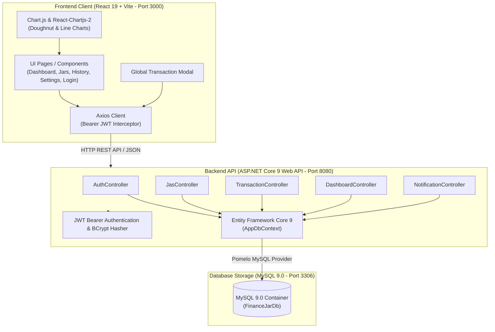
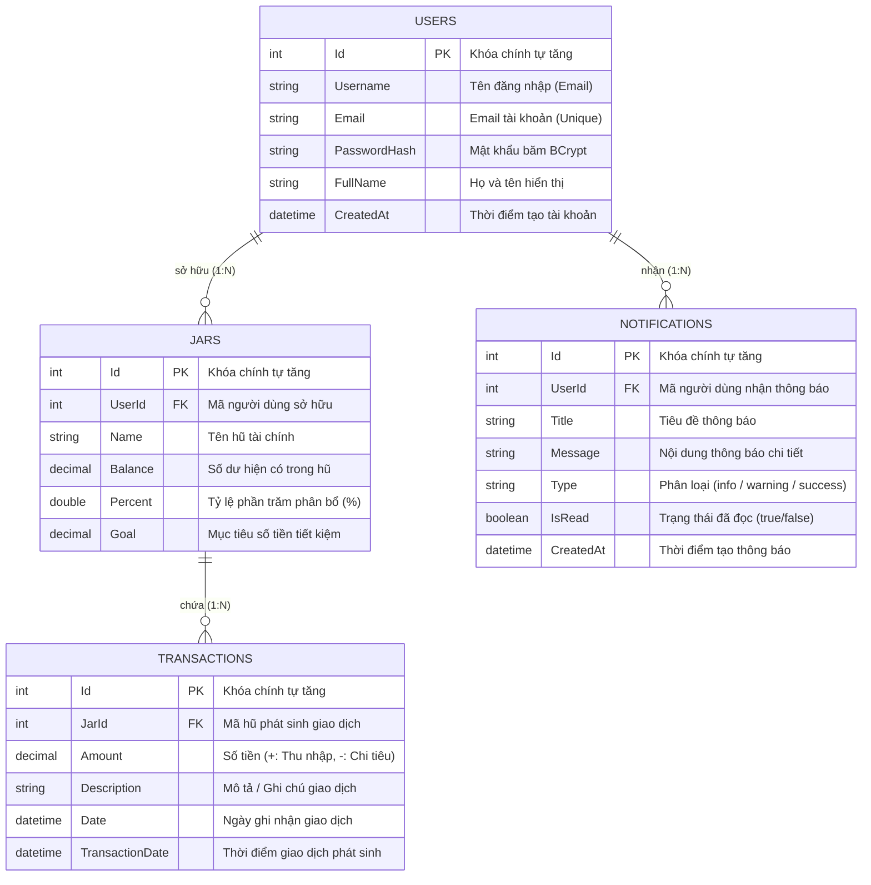

# TÀI LIỆU ĐẶC TẢ HỆ THỐNG QUẢN LÝ TÀI CHÍNH CÁ NHÂN OWLFIN
## (SYSTEM SPECIFICATION - OWLFIN APPLICATION)

> **Tài liệu tham chiếu chuẩn:** `[SRS]TÀI LIỆU THIẾT KẾ HỆ THỐNG_OWLFIN.md`  
> **Phiên bản:** 1.0  
> **Tác giả:** Nguyễn Thị Phương Thảo  
> **Phạm vi hệ thống:** 13 Use Cases cốt lõi theo phương pháp 6 Chiếc Hũ (JARS System) – VJU Minimalist Style.

---

## 1. TỔNG QUAN HỆ THỐNG & KIẾN TRÚC KỸ THUẬT

### 1.1. Mô tả kiến trúc tổng thể (High-Level Architecture)
Hệ thống **OWLFIN** được xây dựng theo kiến trúc phân tầng chuẩn mực **Client - Server (RESTful Web API)**:
* **Tầng Trình diễn (Presentation Layer)**: Ứng dụng Single Page Application (SPA) phát triển trên nền tảng **React 19** và bộ đóng gói **Vite**, tuân thủ ngôn ngữ thiết kế tối giản hiện đại của Đại học Việt Nhật (VJU).
* **Tầng Nghiệp vụ & Dịch vụ (Business Logic & API Layer)**: Xây dựng bằng **ASP.NET Core 9.0 Web API** (C#), đảm nhiệm xác thực bảo mật JWT, tính toán dòng tiền, phân bổ tỷ lệ ngân sách và kiểm tra tính toàn vẹn dữ liệu.
* **Tầng Lưu trữ & Dữ liệu (Data Access Layer)**: Sử dụng **Entity Framework Core 9 (Pomelo MySQL)** để tương tác với hệ quản trị cơ sở dữ liệu quan hệ **MySQL 9.0** được container hóa qua Docker.

---

### 1.2. Ngăn xếp công nghệ (Technology Stack)

| Tầng kiến trúc | Công nghệ / Thư viện | Phiên bản | Vai trò & Mục đích sử dụng |
| :--- | :--- | :---: | :--- |
| **Frontend** | React | 19.2.0 | Xây dựng giao diện người dùng dạng SPA theo mô hình component tái sử dụng |
| | Vite | 7.2.4 | Dev server tốc độ cao với Hot Module Replacement (HMR) và tối ưu build production |
| | React Router DOM | 7.11.0 | Định tuyến điều hướng trang không tải lại (SPA Routing) |
| | Bootstrap / React-Bootstrap | 5.3.8 | Hệ thống lưới Responsive Grid, Form controls, Modals |
| | Chart.js & react-chartjs-2 | 4.5.1 / 5.3.1 | Vẽ biểu đồ tỷ trọng tài sản (Doughnut) và diễn biến dòng tiền (Line) |
| | Axios | 1.13.2 | Thư viện HTTP Client giao tiếp API, cấu hình interceptor gán Bearer Token |
| | SweetAlert2 | 11.26.17 | Hộp thoại thông báo xác nhận và cảnh báo trực quan |
| **Backend** | ASP.NET Core Web API | 9.0 / 10.0 | Nền tảng xây dựng các RESTful endpoints hiệu năng cao |
| | Entity Framework Core | 9.0.0 | ORM quản lý mô hình dữ liệu quan hệ theo phương pháp Code-First |
| | Pomelo.EntityFrameworkCore.MySql | 9.0.0 | Driver kết nối và biên dịch câu truy vấn sang MySQL |
| | Microsoft.AspNetCore.Authentication.JwtBearer | 9.0.0 | Cơ chế xác thực phân quyền không lưu trạng thái (Stateless Authentication) |
| | BCrypt.Net-Next | 4.0.3 | Thuật toán băm mật khẩu một chiều an toàn chống tấn công Rainbow Table |
| | Swashbuckle.AspNetCore (Swagger) | 6.6.2 | Tự động sinh tài liệu OpenAPI 3.0 và giao diện thử nghiệm API tương tác |
| **Cơ sở dữ liệu** | MySQL Server | 9.0 | Hệ quản trị CSDL quan hệ chính (lưu trữ người dùng, hũ, giao dịch, thông báo) |
| **Hạ tầng** | Docker & Docker Compose | Latest | Đóng gói môi trường cơ sở dữ liệu và triển khai đồng nhất |

---

## 2. THIẾT KẾ CƠ SỞ DỮ LIỆU (DATABASE SCHEMA)

### 2.1. Sơ đồ thực thể liên kết (Entity Relationship Diagram - ERD)

### 2.2. Chi tiết cấu trúc các bảng và ràng buộc toàn vẹn

#### Bảng `Users` (Người dùng)
* `Id` (`INT`, Primary Key, Auto Increment): Định danh người dùng.
* `Email` (`VARCHAR(255)`, Not Null, Unique): Địa chỉ email đăng ký tài khoản.
* `Username` (`VARCHAR(255)`, Nullable): Tên đăng nhập người dùng (mặc định bằng Email).
* `PasswordHash` (`VARCHAR(255)`, Not Null): Chuỗi mã hóa băm mật khẩu một chiều bằng giải thuật BCrypt.
* `FullName` (`VARCHAR(100)`, Nullable): Họ và tên đầy đủ hiển thị trên giao diện.
* `CreatedAt` (`DATETIME`, Not Null): Ngày tạo tài khoản.
* **Ràng buộc khóa ngoại**: Khi một `User` bị xóa, toàn bộ `Jars` và `Notifications` liên quan sẽ tự động bị xóa theo chính sách `ON DELETE CASCADE`.

#### Bảng `Jars` (6 Chiếc Hũ Tài Chính)
* `Id` (`INT`, Primary Key, Auto Increment): Định danh hũ.
* `UserId` (`INT`, Foreign Key $\rightarrow$ `Users.Id`, Not Null): Mã người dùng sở hữu hũ.
* `Name` (`VARCHAR(100)`, Not Null): Tên định danh hũ (Ví dụ: "Thiết yếu (NEC)", "Hưởng thụ (PLAY)").
* `Balance` (`DECIMAL(18,2)`, Not Null, Default `0`): Số dư tài chính hiện có trong hũ. Chỉ được phép thay đổi qua nghiệp vụ giao dịch, không cho phép chỉnh sửa tùy tiện qua API cập nhật hũ.
* `Percent` (`DOUBLE`, Not Null): Tỷ lệ % phân bổ nguồn thu nhập (tổng tỷ lệ của tất cả các hũ của một người dùng phải bằng 100%).
* `Goal` (`DECIMAL(18,2)`, Not Null, Default `0`): Mục tiêu số tiền mong muốn tích lũy cho hũ.
* **Ràng buộc**: Mỗi người dùng sở hữu tối đa 10 hũ trong hệ thống. Khi tài khoản đăng ký mới, hệ thống tự động khởi tạo 6 hũ mặc định.

#### Bảng `Transactions` (Giao dịch Thu - Chi)
* `Id` (`INT`, Primary Key, Auto Increment): Định danh giao dịch.
* `JarId` (`INT`, Foreign Key $\rightarrow$ `Jars.Id`, Not Null): Khóa ngoại tham chiếu đến hũ tài chính.
* `Amount` (`DECIMAL(18,2)`, Not Null): Số tiền phát sinh trong giao dịch:
  * **Giá trị dương (`> 0`)**: Giao dịch Thu nhập (nạp tiền vào hũ).
  * **Giá trị âm (`< 0`)**: Giao dịch Chi tiêu (rút tiền từ hũ).
* `Description` (`VARCHAR(200)`, Nullable): Nội dung ghi chú, giải thích lý do thu/chi.
* `Date` (`DATETIME`, Not Null): Ngày ghi nhận phát sinh giao dịch.
* `TransactionDate` (`DATETIME`, Not Null): Thời điểm giao dịch được lưu vào hệ thống.

#### Bảng `Notifications` (Thông báo Hệ thống)
* `Id` (`INT`, Primary Key, Auto Increment): Định danh thông báo.
* `UserId` (`INT`, Foreign Key $\rightarrow$ `Users.Id`, Not Null): Người dùng nhận thông báo.
* `Title` (`VARCHAR(100)`, Not Null): Tiêu đề thông báo ngắn gọn.
* `Message` (`VARCHAR(500)`, Not Null): Chi tiết nội dung thông báo.
* `Type` (`VARCHAR(50)`, Nullable): Loại thông báo (`info`, `warning`, `success`).
* `IsRead` (`BOOLEAN`, Not Null, Default `false`): Trạng thái người dùng đã xem thông báo chưa.
* `CreatedAt` (`DATETIME`, Not Null): Thời điểm phát sinh thông báo.

---

## 3. CHI TIẾT ĐẶC TẢ 13 USE CASES HỆ THỐNG

---

### PHÂN HỆ 1: XÁC THỰC VÀ BẢO MẬT (AUTHENTICATION & IDENTITY)

#### UC001: Đăng ký tài khoản mới (`POST /api/Auth/register`)
* **Mô tả nghiệp vụ**: Cho phép khách truy cập tạo tài khoản cá nhân mới để sử dụng hệ thống.
* **Quy tắc & Kiểm tra tính hợp lệ**:
  1. Kiểm tra Email: Phải đúng định dạng chuẩn RFC và chưa từng tồn tại trong hệ thống.
  2. Kiểm tra Mật khẩu: Tối thiểu 6 ký tự, bắt buộc phải chứa cả chữ và số (`BR-02`).
  3. Băm mật khẩu bằng thuật toán `BCrypt.Net.BCrypt.HashPassword`.
  4. Tạo bản ghi mới trong bảng `Users`.
  5. **Tự động khởi tạo 6 hũ tài chính mặc định**:
     * Hũ 1: Thiết yếu (`NEC`) - 55%
     * Hũ 2: Tự do tài chính (`FFA`) - 10%
     * Hũ 3: Phát triển bản thân (`EDU`) - 10%
     * Hũ 4: Tiết kiệm dài hạn (`LTSS`) - 10%
     * Hũ 5: Hưởng thụ (`PLAY`) - 10%
     * Hũ 6: Cho đi (`GIVE`) - 5%
* **Mã phản hồi HTTP**:
  * `200 OK`: `{ "message": "Đăng ký thành công!" }`
  * `400 Bad Request`: Email đã tồn tại hoặc mật khẩu không đúng định dạng.

#### UC002: Đăng nhập hệ thống & Duy trì phiên (`POST /api/Auth/login`)
* **Mô tả nghiệp vụ**: Xác thực thông tin người dùng và cấp phát JWT Bearer Token.
* **Quy trình xử lý**:
  1. Tìm kiếm User theo Email trong cơ sở dữ liệu.
  2. Nếu không tìm thấy hoặc mật khẩu không khớp khi kiểm tra `BCrypt.Verify`, trả về thông báo lỗi chuẩn xác.
  3. Sinh mã JSON Web Token (JWT) có thời hạn hiệu lực 7 ngày, chứa các Claims:
     * `ClaimTypes.NameIdentifier`: ID người dùng (UserId).
     * `ClaimTypes.Name`: Username hoặc Email.
     * `ClaimTypes.Email`: Email người dùng.
* **Mã phản hồi HTTP**:
  * `200 OK`: `{ "token": "...", "username": "...", "fullName": "...", "email": "..." }`
  * `400 Bad Request`: Thông tin đăng nhập không chính xác.

#### UC003: Cập nhật hồ sơ cá nhân (`PUT /api/Auth/update-profile`)
* **Mô tả nghiệp vụ**: Cho phép người dùng đã đăng nhập thay đổi họ tên hiển thị.
* **Quy tắc**: `FullName` phải có độ dài từ 2 đến 100 ký tự. Không được để trống.
* **Mã phản hồi HTTP**:
  * `200 OK`: Cập nhật thành công, lưu vào CSDL và đồng bộ lại giao diện.
  * `400 Bad Request`: Tên hiển thị không hợp lệ.

#### UC004: Đổi mật khẩu tài khoản (`POST /api/Auth/change-password`)
* **Mô tả nghiệp vụ**: Người dùng thay đổi mật khẩu định kỳ để nâng cao tính bảo mật.
* **Quy trình xử lý**:
  1. Kiểm tra mật khẩu hiện tại `OldPassword` có khớp với hash trong CSDL bằng `BCrypt.Verify`.
  2. Kiểm tra mật khẩu mới `NewPassword`: Phải khác mật khẩu hiện tại, tối thiểu 6 ký tự kết hợp chữ và số.
  3. Băm mật khẩu mới và lưu vào bảng `Users`.
* **Mã phản hồi HTTP**:
  * `200 OK`: Đổi mật khẩu thành công.
  * `400 Bad Request`: Mật khẩu cũ không chính xác hoặc mật khẩu mới không đáp ứng yêu cầu.

---

### PHÂN HỆ 2: QUẢN LÝ 6 CHIẾC HŨ & DASHBOARD (JARS & BUDGETING)

#### UC005: Xem Dashboard & Biểu đồ tổng quan (`GET /api/Dashboard/summary`)
* **Mô tả nghiệp vụ**: Cung cấp bức tranh toàn cảnh về sức khỏe tài chính của người dùng trong tháng hiện tại.
* **Dữ liệu tổng hợp trả về**:
  * $\text{TotalBalance} = \sum \text{Jars.Balance}$ (Tổng số dư tài sản hiện tại).
  * $\text{TotalIncomeMonth} = \sum_{\text{Date} \ge \text{StartOfMonth}} \text{Amount} \quad (\text{với } \text{Amount} > 0)$.
  * $\text{TotalExpenseMonth} = \left| \sum_{\text{Date} \ge \text{StartOfMonth}} \text{Amount} \right| \quad (\text{với } \text{Amount} < 0)$.
  * **Biểu đồ tỷ trọng tài sản (Doughnut Chart)**: Cơ cấu phân bổ tiền mặt giữa các hũ.
  * **Biểu đồ dòng tiền (Line Chart)**: Xu hướng biến động thu/chi qua các mốc thời gian.
  * **5 Giao dịch gần nhất**: Hiển thị trên bảng phụ, sắp xếp theo thứ tự giao dịch mới nhất lên đầu.

#### UC006: Xem danh sách hũ & Ngân sách chi tiêu an toàn mỗi ngày (`GET /api/Jas`)
* **Mô tả nghiệp vụ**: Hiển thị thẻ card cho từng chiếc hũ, bao gồm: Tên hũ, Số dư hiện tại, Tỷ lệ %, Mục tiêu tích lũy và **Ngân sách an toàn mỗi ngày**.
* **Công thức Ngân sách an toàn mỗi ngày (Daily Safe Budget)**:
  $$\text{DailyBudget} = \frac{\text{Jar.Balance}}{\text{RemainingDaysInMonth}}$$
  *Trong đó `RemainingDaysInMonth` tính từ ngày hôm nay đến ngày cuối cùng của tháng hiện tại.*

#### UC007: Thiết lập mục tiêu tích lũy cho hũ (`PUT /api/Jas/{id}`)
* **Mô tả nghiệp vụ**: Người dùng đặt hạn mức số tiền mong muốn đạt được cho từng hũ.
* **Tiến độ hoàn thành mục tiêu**:
  $$\text{ProgressPercent} = \min\left(100\%, \frac{\text{Jar.Balance}}{\text{Jar.Goal}} \times 100\%\right)$$
* **Tự động sinh thông báo chúc mừng**: Khi số dư hũ lần đầu tiên chạm hoặc vượt mục tiêu `Goal > 0`, hệ thống tự động ghi một bản ghi vào bảng `Notifications` với tiêu đề *"Chúc mừng!"* để khích lệ người dùng (`BR-14`).

#### UC008: Tạo mới & Tùy chỉnh hũ (`POST /api/Jas`, `PUT /api/Jas/{id}`, `DELETE /api/Jas/{id}`)
* **Tạo mới hũ (`POST /api/Jas`)**:
  * Kiểm tra số lượng hũ hiện tại của người dùng: Không được vượt quá 10 hũ (`BR-12`).
  * Số dư ban đầu `Balance` luôn được gán bằng `0` từ phía Server.
* **Tùy chỉnh hũ (`PUT /api/Jas/{id}`)**:
  * Cho phép sửa Tên hũ, Tỷ lệ phần trăm phân bổ và Mục tiêu.
  * **Ràng buộc an toàn số dư**: Tuyệt đối không cho phép cập nhật trực tiếp trường `Balance` trong API này.
* **Xóa hũ (`DELETE /api/Jas/{id}`)**:
  * Xóa bỏ hũ và tự động xóa các giao dịch phát sinh thuộc hũ đó.

---

### PHÂN HỆ 3: QUẢN LÝ GIAO DỊCH THU / CHI (TRANSACTIONS)

#### UC009: Ghi nhận giao dịch Thu - Chi (`POST /api/Transactions`)
* **Mô tả nghiệp vụ**: Thao tác ghi chép biến động tài chính từ modal nhập nhanh toàn cục.
* **Quy trình xử lý theo phân loại**:
  1. **Giao dịch Thu nhập (`Amount > 0`)**:
     * Hệ thống duyệt qua tất cả các hũ của người dùng và tính toán số tiền phân bổ:
       $$\Delta \text{Balance}_i = \text{Amount} \times \frac{\text{Jar}_i.\text{Percent}}{100}$$
     * Cộng dồn $\Delta \text{Balance}_i$ vào từng hũ tương ứng.
     * Lưu giao dịch thu nhập vào cơ sở dữ liệu.
  2. **Giao dịch Chi tiêu (`Amount < 0`)**:
     * Kiểm tra tính hợp lệ của `JarId` (người dùng sở hữu hũ này).
     * Trừ trực tiếp số tiền chi tiêu vào hũ được chỉ định:
       $$\text{Jar}.\text{Balance} \leftarrow \text{Jar}.\text{Balance} + \text{Amount}$$
     * Nếu sau khi trừ, số dư hũ bị âm hoặc vượt quá ngân sách an toàn, hệ thống tự động phát sinh thông báo cảnh báo chi tiêu vào bảng `Notifications`.
  3. **Ràng buộc thời gian**: Ngày giao dịch `Date` không được vượt quá ngày hiện tại (không cho phép ghi nhận giao dịch ở tương lai).

#### UC010: Xem lịch sử giao dịch (`GET /api/Transactions`)
* **Mô tả nghiệp vụ**: Liệt kê danh sách tất cả các giao dịch của người dùng.
* **Sắp xếp**: Mặc định sắp xếp theo ngày phát sinh giảm dần (`Date DESC`), giao dịch mới nhất luôn nằm ở đầu danh sách.
* **Định dạng hiển thị**:
  * Số tiền thu nhập: Màu xanh lá cây, có tiền tố `+`, kèm đơn vị `VND`.
  * Số tiền chi tiêu: Màu đỏ Bordeaux, có tiền tố `-`, kèm đơn vị `VND`.

#### UC011: Tìm kiếm & Lọc giao dịch trên giao diện (`History.jsx`)
* **Tìm kiếm theo từ khóa**: Lọc tức thời trên bảng theo nội dung mô tả (`Description`) hoặc tên hũ (`Jar.Name`).
* **Lọc theo loại giao dịch**:
  * Tất cả (Hiển thị đầy đủ).
  * Thu nhập (`Amount > 0`).
  * Chi tiêu (`Amount < 0`).

---

### PHÂN HỆ 4: TRUNG TÂM THÔNG BÁO (NOTIFICATIONS)

#### UC012: Xem Trung tâm thông báo (`GET /api/Notification`)
* **Mô tả nghiệp vụ**: Hiển thị danh sách các thông báo của người dùng, phân loại theo nhóm:
  * `warning`: Cảnh báo chi tiêu vượt ngưỡng, cảnh báo hũ âm tiền.
  * `success`: Chúc mừng đạt mục tiêu tích lũy hũ.
  * `info`: Cập nhật cấu hình hoặc thông báo hệ thống.
* **Sắp xếp**: Theo thời gian tạo giảm dần (`CreatedAt DESC`).

#### UC013: Đánh dấu đã đọc & Xem số chưa đọc (`/api/Notification/unread-count`, `/read`, `/read-all`)
* **Lấy số lượng chưa đọc (`GET /api/Notification/unread-count`)**: Đếm các bản ghi có `IsRead == false` để hiển thị số lượng badge màu đỏ trên icon chuông tại Header.
* **Đánh dấu 1 thông báo đã đọc (`PUT /api/Notification/{id}/read`)**: Chuyển trạng thái `IsRead = true` cho thông báo cụ thể.
* **Đánh dấu tất cả đã đọc (`PUT /api/Notification/read-all`)**: Cập nhật toàn bộ thông báo của người dùng thành đã đọc và xóa huy hiệu thông báo chưa đọc.

---

## 4. BẢNG TỔNG HỢP RESTFUL API ENDPOINTS

| Phương thức | Đường dẫn Endpoint | Xác thực | Mô tả nghiệp vụ |
| :---: | :--- | :---: | :--- |
| **POST** | `/api/Auth/register` | Không | Đăng ký tài khoản mới & khởi tạo 6 hũ mặc định |
| **POST** | `/api/Auth/login` | Không | Xác thực email/mật khẩu & nhận JWT Bearer Token |
| **GET** | `/api/Auth/profile` | Bearer JWT | Lấy thông tin cá nhân của người dùng đăng nhập |
| **PUT** | `/api/Auth/update-profile` | Bearer JWT | Cập nhật họ tên hiển thị trong hồ sơ |
| **POST** | `/api/Auth/change-password` | Bearer JWT | Đổi mật khẩu tài khoản |
| **GET** | `/api/Dashboard/summary` | Bearer JWT | Lấy số liệu tổng tài sản, thu chi tháng & biểu đồ |
| **GET** | `/api/Jas` | Bearer JWT | Lấy danh sách hũ tài chính kèm ngân sách an toàn |
| **POST** | `/api/Jas` | Bearer JWT | Tạo thêm một hũ mới (tối đa 10 hũ/user) |
| **PUT** | `/api/Jas/{id}` | Bearer JWT | Chỉnh sửa tên, tỷ lệ % và mục tiêu hũ |
| **DELETE**| `/api/Jas/{id}` | Bearer JWT | Xóa hũ tài chính và các giao dịch liên quan |
| **GET** | `/api/Transactions` | Bearer JWT | Lấy danh sách lịch sử giao dịch (hỗ trợ lọc từ khóa) |
| **POST** | `/api/Transactions` | Bearer JWT | Thêm giao dịch thu nhập / chi tiêu và điều chỉnh số dư |
| **GET** | `/api/Notification` | Bearer JWT | Lấy danh sách thông báo của người dùng |
| **GET** | `/api/Notification/unread-count`| Bearer JWT | Đếm số lượng thông báo chưa đọc |
| **PUT** | `/api/Notification/{id}/read` | Bearer JWT | Đánh dấu một thông báo cụ thể là đã đọc |
| **PUT** | `/api/Notification/read-all` | Bearer JWT | Đánh dấu tất cả thông báo của người dùng là đã đọc |

---

## 5. BẢNG DANH MỤC QUY TẮC NGHIỆP VỤ (BUSINESS RULES)

| Mã quy tắc | Tên quy tắc | Nội dung chi tiết |
| :---: | :--- | :--- |
| **BR-01** | Định dạng Email | Email đăng ký phải đúng định dạng chuẩn RFC và là duy nhất trong toàn hệ thống. |
| **BR-02** | Độ phức tạp mật khẩu | Mật khẩu phải có độ dài tối thiểu 6 ký tự, bắt buộc phải có ít nhất một ký tự chữ và một chữ số. |
| **BR-03** | Duy trì phiên làm việc | JWT Token có hiệu lực 7 ngày kể từ thời điểm đăng nhập thành công. |
| **BR-04** | Cập nhật hồ sơ | Tên người dùng hiển thị phải có độ dài từ 2 đến 100 ký tự. |
| **BR-05** | Mật khẩu mới | Mật khẩu mới khi đổi phải khác mật khẩu hiện tại và đáp ứng quy tắc BR-02. |
| **BR-06** | 6 Hũ mặc định | Khởi tạo tài khoản tự động sinh 6 hũ: Thiết yếu 55%, Tự do tài chính 10%, Giáo dục 10%, Tiết kiệm 10%, Hưởng thụ 10%, Cho đi 5%. |
| **BR-07** | Tổng tỷ lệ phân bổ | Tổng tỷ lệ phần trăm phân bổ của tất cả các hũ thuộc một tài khoản luôn luôn phải bằng đúng 100%. |
| **BR-08** | Toàn vẹn số dư hũ | Số dư hũ `Balance` chỉ được phép thay đổi thông qua phát sinh giao dịch, không cho phép chỉnh sửa thủ công qua API cập nhật hũ. |
| **BR-09** | Phân bổ thu nhập tự động | Khi ghi nhận khoản thu nhập, số tiền tự động chia vào các hũ theo đúng tỷ lệ phần trăm đã cài đặt. |
| **BR-10** | Ngân sách an toàn/ngày | Ngân sách chi tiêu an toàn mỗi ngày của hũ được tính bằng: $\text{Số dư hũ} / \text{Số ngày còn lại trong tháng}$. |
| **BR-11** | Thời gian giao dịch | Ngày giao dịch không được phép vượt quá ngày hiện tại (không chấp nhận giao dịch trong tương lai). |
| **BR-12** | Giới hạn số lượng hũ | Mỗi người dùng được phép tạo tối đa 10 hũ trong hệ thống. |
| **BR-13** | Kiểm tra quyền sở hữu (IDOR)| Người dùng chỉ có quyền đọc, ghi, sửa, xóa trên các tài nguyên (Hũ, Giao dịch, Thông báo) do chính mình sở hữu. |
| **BR-14** | Thông báo đạt mục tiêu | Khi số dư hũ đạt hoặc vượt mục tiêu lần đầu tiên, hệ thống tự động sinh thông báo chúc mừng vào hộp thư. |

---

## 6. THIẾT KẾ GIAO DIỆN & BẢN SẮC VJU (UI/UX SPECIFICATION)

### 6.1. Bảng màu chủ đạo (VJU Color Palette)
* **Màu nhận diện thương hiệu VJU**:
  * Đỏ Bordeaux chính (Primary Accent): `#8B1D24`
  * Đỏ Bordeaux đậm (Hover / Active): `#6B141A`
  * Đỏ tươi nhấn mạnh (Badge / Warning): `#A31D24`
* **Màu trung tính & Nền**:
  * Nền chính ứng dụng: `#F8F9FA`
  * Nền thẻ Card / Modal: `#FFFFFF`
  * Màu viền phân tách: `#E9ECEF`
  * Màu chữ tiêu đề: `#212529`
  * Màu chữ phụ / Nhãn mô tả: `#6C757D`
* **Màu sắc trạng thái giao dịch**:
  * Thu nhập (Income / Positive): Xanh lá cây `#198754`
  * Chi tiêu (Expense / Negative): Đỏ `#DC3545`

### 6.2. Cấu trúc bố cục trang (Layout Structure)
* **Sidebar cố định bên trái**:
  * Chứa Logo Đại học Việt Nhật (VJU) và tên ứng dụng OWLFIN.
  * Menu điều hướng các trang chính: **Dashboard**, **Quản lý Hũ**, **Lịch sử Giao dịch**, **Cài đặt**.
  * Nút bấm hành động nhanh nổi bật: **"Thêm Giao Dịch"** mở hộp thoại modal toàn cục.
* **Header cố định phía trên**:
  * Hiển thị ngày giờ thực tế theo định dạng tiếng Việt.
  * Icon quả chuông trung tâm thông báo có huy hiệu đỏ đếm số thông báo chưa đọc.
  * Khối hồ sơ người dùng (Avatar viết tắt, Tên hiển thị, Nút Đăng xuất).
* **Khu vực nội dung chính (Main Content Area)**:
  * Hiển thị nội dung tương ứng theo URL route (`/`, `/jars`, `/history`, `/settings`, `/login`).
  * Tự động co giãn theo chuẩn Responsive Bootstrap Grid (hỗ trợ màn hình máy tính bàn, laptop và thiết bị di động).
