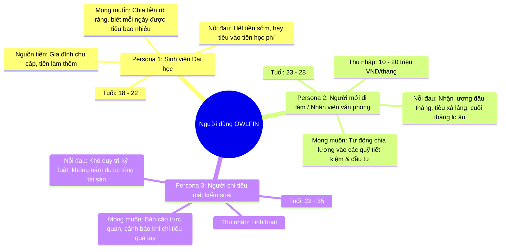
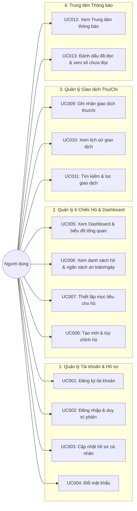

# TÀI LIỆU YÊU CẦU NGƯỜI DÙNG (USER REQUIREMENTS DOCUMENT - URD)
# DỰ ÁN: OWLFIN - HỆ THỐNG QUẢN LÝ TÀI CHÍNH CÁ NHÂN THEO PHƯƠNG PHÁP 6 CHIẾC HŨ

---

## 1. GIỚI THIỆU VÀ BỐI CẢNH DỰ ÁN (PROJECT BACKGROUND)

### 1.1. Bối cảnh thực tế & Bài toán đặt ra
Trong thời đại kinh tế số, các phương thức thanh toán không dùng tiền mặt (chuyển khoản ngân hàng, ví điện tử, quét mã QR) phát triển mạnh mẽ giúp việc mua sắm trở nên thuận tiện hơn bao giờ hết. Tuy nhiên, sự tiện lợi này cũng mang đến thách thức lớn trong việc quản lý chi tiêu cá nhân:
* **Chi tiêu theo cảm xúc, thiếu kế hoạch**: Phần lớn các bạn trẻ (sinh viên, người mới đi làm) thường rơi vào tình trạng "cháy túi" vào giữa hoặc cuối tháng do không có kế hoạch phân bổ dòng tiền rõ ràng ngay từ khi có thu nhập.
* **Ghi chép thủ công phức tạp và khó duy trì**: Nhiều ứng dụng sổ thu chi trên thị trường yêu cầu thao tác phức tạp, phân loại danh mục rườm rà khiến người dùng nhanh chóng bỏ cuộc.
* **Thiếu công cụ định lượng ngân sách hàng ngày**: Người dùng chỉ biết tổng số tiền mình còn lại nhưng không biết cụ thể mỗi ngày được phép tiêu tối đa bao nhiêu tiền để duy trì mức sống an toàn đến kỳ nhận tiền tiếp theo.
* **Không áp dụng phương pháp quản lý dòng tiền khoa học**: Đa số người dùng để chung toàn bộ tiền vào một tài khoản duy nhất, dẫn đến việc các chi phí sinh hoạt thiết yếu bị lấn sang tiền tiết kiệm hoặc tiền đầu tư tương lai.

### 1.2. Tầm nhìn sản phẩm (Product Vision)
**OWLFIN** được phát triển nhằm mục tiêu trở thành **Hệ thống Quản lý Tài chính Cá nhân Tinh gọn, Khoa học và Chuẩn mực**, đồng hành cùng người dùng trong việc:
1. **Đơn giản hóa phương pháp 6 Chiếc Hũ (JARS System)** của T. Harv Eker, giúp phân loại dòng tiền rành mạch vào 6 quỹ độc lập ngay khi nhận thu nhập.
2. **Tự động hóa phân bổ ngân sách**: Chỉ cần nhập tổng thu nhập, hệ thống sẽ tự động nhân theo tỷ lệ phần trăm cấu hình và rót tiền vào các hũ.
3. **Định lượng ngân sách an toàn mỗi ngày (Daily Safe Budget)**: Tính toán số tiền được phép chi tiêu tối đa mỗi ngày trong thời gian thực dựa trên số dư hũ và số ngày còn lại của tháng.
4. **Cảnh báo chi tiêu chủ động**: Giúp người dùng nhận diện ngay khi chi tiêu chạm ngưỡng nguy hiểm hoặc khi hoàn thành các cột mốc tiết kiệm mong đợi.
5. **Giao diện nhận diện thương hiệu VJU**: Thiết kế tối giản, thanh lịch với tông màu chủ đạo Đỏ Bordeaux, Trắng và Xám ghi, mang lại sự chuyên nghiệp và trực quan.

---

## 2. CHÂN DUNG NGƯỜI DÙNG MỤC TIÊU (USER PERSONAS)

### 2.1. Persona 1: Nguyễn Thùy Linh - Sinh viên Đại học (21 tuổi)
* **Thu nhập**: 3,500,000 VND (chu cấp từ phụ huynh) + 2,000,000 VND (gia sư bán thời gian).
* **Thực trạng**: Thường xuyên tiêu hết tiền vào 10 ngày đầu tháng do mua sắm và tụ tập bạn bè, đến cuối tháng phải vay mượn để trang trải tiền ăn.
* **Mục tiêu**: Muốn có công cụ tính sẵn mỗi ngày chỉ được phép tiêu tối đa bao nhiêu tiền để không bao giờ bị đói cuối tháng, đồng thời trích riêng được 10% tiền để học tiếng Nhật.

### 2.2. Persona 2: Trần Quốc Huy - Nhân viên lập trình mới đi làm (24 tuổi)
* **Thu nhập**: 16,000,000 VND / tháng (nhận vào ngày 05 hàng tháng).
* **Thực trạng**: Tiền để chung trong tài khoản ngân hàng, không phân định giữa tiền nhà, ăn uống với tiền tích lũy mua xe máy mới.
* **Mục tiêu**: Khi có lương tháng, chỉ cần nhập 1 lệnh là hệ thống tự chia ngay 55% cho sinh hoạt, 10% tiết kiệm dài hạn, 10% học tập và 10% giải trí.

### 2.3. Persona 3: Vũ Mai Anh - Nhân viên Marketing (27 tuổi)
* **Thu nhập**: 20,000,000 VND / tháng.
* **Thực trạng**: Chi tiêu thẻ tín dụng nhiều, thường xuyên quên các khoản chi nhỏ lẻ và không theo dõi được tỷ trọng tài sản của mình đang phân bổ ra sao.
* **Mục tiêu**: Cần một Dashboard trực quan với biểu đồ phân bổ tài sản, hiển thị cảnh báo khi chi tiêu vượt ngân sách và có danh sách lịch sử tra cứu nhanh gọn.

---

## 3. CÁC CÂU CHUYỆN NGƯỜI DÙNG (USER STORIES)

Các yêu cầu người dùng được cấu trúc theo định dạng chuẩn Agile: `Là một [Đối tượng], tôi muốn [Hành động/Chức năng], để [Lợi ích/Giá trị]`.

### Phân hệ 1: Quản lý Tài khoản & Hồ sơ cá nhân
* **US-01**: *Là một người dùng mới*, tôi muốn đăng ký tài khoản bằng Email, Họ tên và Mật khẩu an toàn, *để tôi có không gian quản lý tài chính riêng tư và bảo mật*.
* **US-02**: *Là một người dùng*, tôi muốn đăng nhập hệ thống và duy trì trạng thái đăng nhập trong 7 ngày, *để tôi không phải gõ lại thông tin mỗi lần mở ứng dụng trên thiết bị cá nhân*.
* **US-03**: *Là một người dùng*, tôi muốn xem và cập nhật họ tên hiển thị trong trang cài đặt, *để thông tin cá nhân trên giao diện luôn chính xác và thân thuộc*.
* **US-04**: *Là một người dùng*, tôi muốn thay đổi mật khẩu tài khoản bằng cách nhập mật khẩu hiện tại và mật khẩu mới, *để tôi chủ động bảo vệ tài khoản khi cần thiết*.

### Phân hệ 2: Quản lý 6 Chiếc Hũ & Ngân sách chi tiêu
* **US-05**: *Là một người dùng mới đăng ký*, tôi muốn hệ thống tự động khởi tạo sẵn 6 hũ tài chính theo tỷ lệ chuẩn (Thiết yếu 55%, Tự do tài chính 10%, Giáo dục 10%, Tiết kiệm 10%, Hưởng thụ 10%, Cho đi 5%), *để tôi có thể bắt đầu sử dụng ngay mà không cần cấu hình thủ công phức tạp*.
* **US-06**: *Là một người dùng*, tôi muốn xem số dư thực tế, tỷ lệ phần trăm phân bổ và số tiền của từng chiếc hũ, *để tôi nắm bắt được cấu trúc dòng tiền hiện tại của mình*.
* **US-07**: *Là một người dùng*, tôi muốn biết ngân sách chi tiêu an toàn mỗi ngày cho từng hũ trong tháng, *để tôi chủ động điều tiết mức chi tiêu hôm nay mà không lo âm tiền cuối tháng*.
* **US-08**: *Là một người dùng*, tôi muốn đặt mục tiêu số tiền tích lũy cho từng hũ (như mua laptop, học chứng chỉ) và xem thanh tiến độ hoàn thành, *để tôi có thêm động lực duy trì kỷ luật tài chính*.
* **US-09**: *Là một người dùng*, tôi muốn tùy chỉnh tỷ lệ phần trăm các hũ (với tổng luôn bằng 100%) hoặc tạo thêm hũ theo nhu cầu riêng (tối đa 10 hũ), *để hệ thống phản ánh đúng lối sống thực tế của tôi*.

### Phân hệ 3: Ghi nhận Giao dịch Thu - Chi
* **US-10**: *Là một người dùng*, tôi muốn có nút "Thêm Giao Dịch" nhanh ở mọi màn hình, *để tôi có thể ghi chép ngay khoản thu chi vừa phát sinh*.
* **US-11**: *Là một người dùng*, khi tôi chọn loại giao dịch "Thu Nhập", tôi muốn hệ thống tự động phân bổ số tiền vào 6 hũ theo tỷ lệ phần trăm đã cài đặt, *để tôi không phải tự bấm máy tính chia nhỏ từng khoản*.
* **US-12**: *Là một người dùng*, khi tôi ghi nhận một khoản "Chi Tiêu", tôi muốn chọn hũ chi trả để hệ thống trừ tiền trực tiếp vào hũ đó, *để số dư các hũ luôn được cập nhật chính xác*.
* **US-13**: *Là một người dùng*, tôi muốn xem danh sách toàn bộ lịch sử giao dịch và tìm kiếm theo từ khóa hoặc lọc theo Thu/Chi, *để tôi dễ dàng kiểm tra, đối chiếu lại các chi tiêu cũ*.

### Phân hệ 4: Dashboard & Trung tâm Thông báo
* **US-14**: *Là một người dùng*, tôi muốn xem bảng điều khiển tổng quan (Dashboard) hiển thị: Tổng tài sản, Tổng thu trong tháng, Tổng chi trong tháng, biểu đồ cơ cấu tài sản và biểu đồ diễn biến dòng tiền, *để tôi có cái nhìn toàn cảnh về sức khỏe tài chính của mình*.
* **US-15**: *Là một người dùng*, tôi muốn nhận được thông báo trong ứng dụng khi chi tiêu chạm ngưỡng cảnh báo hoặc khi hũ đạt mục tiêu tiết kiệm, *để tôi có các điều chỉnh tài chính kịp thời*.
* **US-16**: *Là một người dùng*, tôi muốn xem số lượng thông báo chưa đọc và đánh dấu đã đọc từng thông báo hoặc tất cả, *để trung tâm thông báo của tôi luôn gọn gàng*.

---

## 4. QUY TRÌNH NGHIỆP VỤ & SƠ ĐỒ USE CASE TỔNG THỂ

### 4.1. Sơ đồ 13 Use Cases cốt lõi

### 4.2. Kịch bản trải nghiệm điển hình (Core User Scenarios)

#### Kịch bản 1: Người dùng mới tham gia hệ thống
1. Người dùng mở trang web OWLFIN, truy cập liên kết **Đăng ký**.
2. Nhập Email, Họ và tên, Mật khẩu an toàn (tối thiểu 6 ký tự kết hợp chữ và số).
3. Hệ thống kiểm tra hợp lệ, tạo tài khoản và tự động khởi tạo sẵn **6 Hũ Tài Chính Chuẩn**:
   * Thiết yếu (`NEC` - 55%)
   * Tự do tài chính (`FFA` - 10%)
   * Phát triển bản thân (`EDU` - 10%)
   * Tiết kiệm dài hạn (`LTSS` - 10%)
   * Hưởng thụ (`PLAY` - 10%)
   * Cho đi (`GIVE` - 5%)
4. Người dùng đăng nhập vào hệ thống và được điều hướng ngay tới trang **Dashboard** với số dư ban đầu là 0 VND.

#### Kịch bản 2: Ghi nhận Thu nhập & Tự động phân bổ vào 6 hũ
1. Đầu tháng, người dùng nhận được tiền lương 15,000,000 VND.
2. Nhấp vào nút **"Thêm Giao Dịch"** tại Header hoặc thanh Sidebar.
3. Chọn loại: **"Thu Nhập"**, nhập số tiền `15,000,000`, mô tả: "Lương tháng này", chọn ngày hiện tại.
4. Bấm **"Lưu Giao Dịch"**.
5. Hệ thống tự động phân bổ:
   * Hũ Thiết yếu (+8,250,000 VND)
   * Hũ Tự do tài chính (+1,500,000 VND)
   * Hũ Giáo dục (+1,500,000 VND)
   * Hũ Tiết kiệm (+1,500,000 VND)
   * Hũ Hưởng thụ (+1,500,000 VND)
   * Hũ Cho đi (+750,000 VND)
6. Số dư tổng và ngân sách an toàn mỗi ngày trên Dashboard tăng lên ngay lập tức.

#### Kịch bản 3: Chi tiêu hàng ngày & Giám sát ngân sách an toàn
1. Người dùng đi ăn trưa và thanh toán 60,000 VND.
2. Mở ứng dụng, chọn **"Thêm Giao Dịch"** $\rightarrow$ **"Chi Tiêu"**.
3. Nhập số tiền `60,000`, chọn nguồn tiền: Hũ **"Thiết yếu"**, nhập mô tả: "Ăn trưa cơm văn phòng".
4. Bấm **"Lưu Giao Dịch"**. Số dư hũ Thiết yếu được trừ 60,000 VND.
5. Người dùng vào trang **"Quản lý Hũ"** để xem ngân sách an toàn còn lại cho các ngày tiếp theo trong tháng.

---

## 5. YÊU CẦU PHI CHỨC NĂNG (NON-FUNCTIONAL REQUIREMENTS)

| Nhóm yêu cầu | Tiêu chí | Mô tả chi tiết từ góc nhìn người dùng |
| :--- | :--- | :--- |
| **Giao diện & Trải nghiệm (UI/UX)** | Bản sắc VJU Style | Tông màu chủ đạo Đỏ Bordeaux (`#8B1D24` / `#A31D24`), Trắng và Xám ghi. Thiết kế tối giản, loại bỏ chi tiết thừa, làm nổi bật số liệu tài chính. |
| | Định dạng chuẩn mực | Tiền tệ luôn định dạng phân cách hàng nghìn có đơn vị `VND` (VD: `1,500,000 VND`). Thời gian hiển thị định dạng Việt Nam `DD/MM/YYYY`. |
| | Tính tương thích đa thiết bị | Giao diện Responsive hoạt động mượt mà trên Desktop, Laptop, Tablet và Mobile. |
| **Hiệu năng & Tốc độ (Performance)** | Tốc độ phản hồi | Tải trang Dashboard dưới 1.5 giây; ghi nhận giao dịch thu/chi hoàn tất dưới 1 giây. |
| **Bảo mật & Quyền riêng tư (Security)** | Mã hóa thông tin | Mật khẩu người dùng được băm một chiều an toàn bằng thuật toán BCrypt. Không ai có thể đọc được mật khẩu gốc. |
| | Cô lập dữ liệu cá nhân | Cơ chế kiểm tra quyền truy cập (IDOR Prevention): Mỗi người dùng chỉ xem và thao tác trên dữ liệu Hũ, Giao dịch và Thông báo của chính mình. |
| | Xác thực phiên | Token xác thực JWT có thời hạn 7 ngày, tự động gắn vào Header các yêu cầu gọi API. |
| **Độ tin cậy & Toàn vẹn (Reliability)** | Chính xác tài chính | Các phép tính số dư, phân bổ phần trăm và ngân sách an toàn mỗi ngày phải đảm bảo độ chính xác tuyệt đối, không làm mất mát số dư. |

---

## 6. TIÊU CHÍ NGHIỆM THU NGƯỜI DÙNG (USER ACCEPTANCE CRITERIA - UAC)

* **UAC-01 (Đăng ký tài khoản - UC001)**: Đạt khi người dùng nhập đủ Email, Họ tên và Mật khẩu hợp lệ (chữ và số) thì đăng ký thành công, tự động khởi tạo 6 hũ mặc định; nhập mật khẩu không đủ độ phức tạp hoặc email đã tồn tại thì hiển thị thông báo lỗi rõ ràng.
* **UAC-02 (Đăng nhập - UC002)**: Đạt khi nhập đúng tài khoản thì chuyển hướng ngay vào Dashboard và lưu token phiên; nhập sai email hoặc mật khẩu thì nhận thông báo chuẩn xác; tải lại trang (F5) không bị mất phiên đăng nhập.
* **UAC-03 (Cập nhật hồ sơ - UC003)**: Đạt khi sửa đổi họ tên hợp lệ (từ 2 đến 100 ký tự) thì tên hiển thị trên Sidebar và Header được cập nhật tức thì.
* **UAC-04 (Đổi mật khẩu - UC004)**: Đạt khi nhập đúng mật khẩu hiện tại và mật khẩu mới khác mật khẩu cũ thì đổi mật khẩu thành công.
* **UAC-05 (Dashboard tổng quan - UC005)**: Đạt khi Dashboard hiển thị đúng Tổng số dư, Tổng thu trong tháng, Tổng chi trong tháng; biểu đồ Doughnut cơ cấu hũ và biểu đồ Line dòng tiền vẽ chính xác dữ liệu thực tế.
* **UAC-06 (Danh sách hũ & Ngân sách an toàn - UC006)**: Đạt khi hiển thị đủ 6 hũ với số dư, tỷ lệ % và ngân sách an toàn mỗi ngày được tính chính xác theo công thức: $\text{Số dư} / \text{Số ngày còn lại trong tháng}$.
* **UAC-07 (Mục tiêu hũ - UC007)**: Đạt khi thiết lập số tiền mục tiêu thì thanh phần trăm tiến độ cập nhật chính xác theo tỷ lệ $\text{Số dư} / \text{Mục tiêu} \times 100\%$.
* **UAC-08 (Tùy chỉnh hũ - UC008)**: Đạt khi người dùng có thể đổi tên, đổi % phân bổ (tổng bằng 100%), tạo mới hũ (không vượt quá 10 hũ) hoặc xóa hũ thành công.
* **UAC-09 (Ghi nhận giao dịch - UC009)**: Đạt khi thêm giao dịch Thu nhập thì tiền được tự động chia vào các hũ theo tỷ lệ %; thêm giao dịch Chi tiêu thì số dư hũ bị trừ chính xác và số tiền âm/dương được phân loại rõ ràng.
* **UAC-10 (Lịch sử giao dịch - UC010)**: Đạt khi danh sách giao dịch hiển thị theo thứ tự mới nhất ở trên cùng, có tên hũ, ngày thực hiện, mô tả và số tiền phân biệt màu xanh (thu) / đỏ (chi).
* **UAC-11 (Tìm kiếm & Lọc - UC011)**: Đạt khi gõ từ khóa tìm kiếm thì bảng lọc kết quả tức thời theo mô tả/tên hũ; chọn tab Thu nhập/Chi tiêu thì chỉ hiện các giao dịch thuộc loại đó.
* **UAC-12 (Xem thông báo - UC012)**: Đạt khi mở trung tâm thông báo thì thấy danh sách thông báo cảnh báo và biến động tài sản được sắp xếp theo thời gian mới nhất.
* **UAC-13 (Đánh dấu đã đọc - UC013)**: Đạt khi số huy hiệu trên chuông thông báo giảm tương ứng khi bấm đọc từng thông báo hoặc về 0 khi chọn "Đánh dấu tất cả đã đọc".
