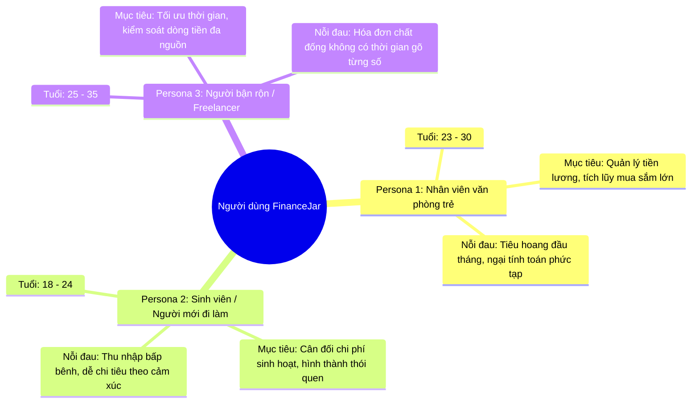
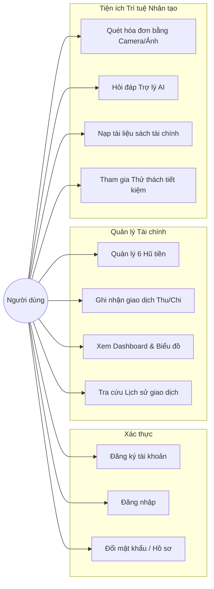

# TÀI LIỆU YÊU CẦU NGƯỜI DÙNG (USER REQUIREMENTS DOCUMENT - URD)
# DỰ ÁN: FINANCEJAR - ỨNG DỤNG QUẢN LÝ TÀI CHÍNH CÁ NHÂN TÍCH HỢP AI

---

## 1. GIỚI THIỆU VÀ BỐI CẢNH DỰ ÁN (PROJECT BACKGROUND)

### 1.1. Bối cảnh thực tế & Bài toán đặt ra
Trong bối cảnh kinh tế số và xu hướng thanh toán không dùng tiền mặt phát triển nhanh chóng, việc kiểm soát chi tiêu cá nhân trở thành một thách thức lớn đối với đa số người trẻ và người đi làm:
* **Chi tiêu thiếu định hướng**: Người dùng thường rơi vào tình trạng "cháy túi" vào cuối tháng do không có kế hoạch phân bổ tài chính rõ ràng ngay khi nhận lương.
* **Ngại ghi chép thủ công**: Các ứng dụng sổ thu chi truyền thống đòi hỏi người dùng phải tự gõ từng dòng giao dịch, mất nhiều thời gian dẫn đến việc bỏ dở chỉ sau vài ngày sử dụng.
* **Thiếu kiến thức quản lý tài chính bài bản**: Đa số người dùng không biết cách áp dụng các mô hình tài chính chuẩn mực (như quy tắc 6 Chiếc Hũ của T. Harv Eker hay quy tắc 50/30/20).
* **Thiếu sự đồng hành và động lực**: Việc tiết kiệm thường nhàm chán, thiếu những lời khuyên kịp thời hoặc các thử thách tạo động lực duy trì thói quen tài chính tích cực.

### 1.2. Tầm nhìn sản phẩm (Product Vision)
**FinanceJar** được định vị là **Người bạn đồng hành tài chính thông minh 24/7**, giúp người dùng:
1. Đơn giản hóa việc phân bổ thu nhập theo phương pháp khoa học đã được kiểm chứng.
2. Tối ưu hóa thời gian ghi chép nhờ công nghệ nhận diện hóa đơn tự động từ ảnh chụp.
3. Nhận được sự tư vấn tài chính được cá nhân hóa cao từ Trợ lý Trí tuệ Nhân tạo.
4. Xây dựng thói quen tiết kiệm bền vững thông qua các thử thách thực tế hàng tuần.

---

## 2. CHÂN DUNG NGƯỜI DÙNG MỤC TIÊU (USER PERSONAS)

### 2.1. Persona 1: Nguyễn Minh Anh - Nhân viên văn phòng (25 tuổi)
* **Thu nhập**: 15,000,000 VND / tháng.
* **Hành vi**: Nhận lương vào đầu tháng, thường xuyên mua sắm online, đi ăn ngoài và hay thắc mắc "không hiểu tiền đã đi đâu".
* **Mong muốn**: Muốn một ứng dụng tự động nhắc nhở mỗi ngày được tiêu tối đa bao nhiêu tiền để không bị hết tiền trước ngày nhận lương tiếp theo.

### 2.2. Persona 2: Lê Tuấn Kiệt - Freelancer / Người bận rộn (28 tuổi)
* **Thu nhập**: Dao động theo dự án (15 - 30 triệu VND).
* **Hành vi**: Giữ rất nhiều hóa đơn mua sắm, tiền nhà, quán cà phê nhưng không có thời gian ngồi nhập liệu từng khoản.
* **Mong muốn**: Chỉ cần chụp hình hóa đơn là ứng dụng tự bóc tách và phân loại vào đúng mục chi tiêu.

### 2.3. Persona 3: Trần Hoàng Yến - Sinh viên năm cuối chuẩn bị đi làm (22 tuổi)
* **Thu nhập**: 4,000,000 VND (làm thêm) + hỗ trợ từ gia đình.
* **Hành vi**: Chưa có nhiều kiến thức tài chính, muốn học cách tiết kiệm tiền để học thêm chứng chỉ và du lịch.
* **Mong muốn**: Muốn có một chuyên gia AI có thể giải đáp các thắc mắc về phân bổ tiền bạc và đưa ra các thử thách tiết kiệm thú vị, dễ thực hiện.

---

## 3. CÁC CÂU CHUYỆN NGƯỜI DÙNG (USER STORIES)

Các yêu cầu được xây dựng theo chuẩn Agile `As a [User Role], I want [Feature / Action], so that [Business Benefit / Value]`:

### Nhóm 1: Quản lý Tài khoản & Cá nhân hóa
* **US-01**: *Là một người dùng mới*, tôi muốn có thể đăng ký tài khoản nhanh chóng bằng Email và Mật khẩu, *để tôi có thể bắt đầu quản lý tài chính cá nhân an toàn*.
* **US-02**: *Là một người dùng*, tôi muốn hệ thống ghi nhớ trạng thái đăng nhập của tôi trong nhiều ngày, *để tôi không phải nhập lại mật khẩu mỗi lần mở ứng dụng*.
* **US-03**: *Là một người dùng*, tôi muốn có thể cập nhật họ tên và đổi mật khẩu bất kỳ lúc nào, *để tôi bảo vệ an toàn cho tài khoản và thông tin tài chính của mình*.

### Nhóm 2: Phương pháp 6 Chiếc Hũ Thông Minh
* **US-04**: *Là một người dùng*, tôi muốn xem danh sách các hũ tiền với số dư hiện tại và tỷ lệ phần trăm phân bổ, *để tôi nắm được cấu trúc tài sản của mình*.
* **US-05**: *Là một người dùng*, tôi muốn thiết lập mục tiêu số tiền tích lũy cho từng hũ, *để tôi theo dõi mức độ hoàn thành ước mơ tài chính của mình (mua nhà, học tập, du lịch)*.
* **US-06**: *Là một người dùng*, tôi muốn biết được "Ngân sách chi tiêu an toàn mỗi ngày" cho từng hũ, *để tôi chủ động kiểm soát chi tiêu hàng ngày mà không bị âm tiền cuối tháng*.
* **US-07**: *Là một người dùng*, tôi muốn tạo thêm hoặc tùy chỉnh tên các hũ, *để ứng dụng phù hợp với nhu cầu chi tiêu đặc thù của riêng tôi*.

### Nhóm 3: Ghi chép & Quản lý Thu - Chi
* **US-08**: *Là một người dùng*, tôi muốn ghi nhận nhanh một khoản thu nhập hoặc chi tiêu từ bất kỳ màn hình nào, *để tôi không bỏ sót bất kỳ biến động tiền bạc nào*.
* **US-09**: *Là một người dùng*, tôi muốn số tiền nhập vào được hiển thị tự động bằng dấu phẩy phân cách hàng nghìn (VD: 500,000), *để tôi không bị nhầm lẫn giữa 50 nghìn và 500 nghìn*.
* **US-10**: *Là một người dùng*, tôi muốn xem lại toàn bộ lịch sử thu chi theo thứ tự thời gian, *để tôi đánh giá lại thói quen chi tiêu của mình*.
* **US-11**: *Là một người dùng*, tôi muốn tìm kiếm giao dịch theo từ khóa (nội dung, tên hũ) và lọc theo Thu nhập / Chi tiêu, *để tôi nhanh chóng tra cứu lại giao dịch cũ*.

### Nhóm 4: Quét Hóa Đơn Tự Động bằng AI (OCR)
* **US-12**: *Là một người dùng bận rộn*, tôi muốn chụp hoặc tải ảnh hóa đơn mua sắm lên ứng dụng, *để hệ thống tự động nhận diện tên quán, ngày tháng và tổng tiền thay vì tôi phải tự gõ*.
* **US-13**: *Là một người dùng*, tôi muốn được xem trước ảnh chụp và chỉnh sửa thông tin nhận diện trước khi lưu, *để đảm bảo số liệu vào sổ luôn chính xác tuyệt đối*.
* **US-14**: *Là một người dùng*, tôi muốn hệ thống tự động gợi ý hũ phù hợp (như "Thiết yếu") và lưu khoản chi chỉ với 1 cú nhấp chuột, *để tối ưu hóa thời gian thao tác*.

### Nhóm 5: Trợ lý Cố vấn Tài chính AI (RAG Chatbot)
* **US-15**: *Là một người dùng*, tôi muốn trò chuyện trực tiếp với Trợ lý Tài chính AI bằng tiếng Việt tự nhiên, *để được tư vấn về cách chia tiền, tiết kiệm và quản lý chi tiêu*.
* **US-16**: *Là một người dùng*, tôi muốn trợ lý AI có khả năng học từ các tài liệu tài chính chuyên sâu (PDF, sách tài chính), *để câu trả lời của AI có căn cứ học thuật và giá trị thực tiễn cao*.
* **US-17**: *Là một người dùng*, tôi muốn AI ghi nhớ các đoạn hội thoại trước đó trong cùng phiên, *để cuộc trao đổi diễn ra mạch lạc, tự nhiên như trò chuyện với chuyên gia thực thụ*.
* **US-18**: *Là một người dùng*, tôi muốn các lời khuyên có cấu trúc bảng biểu, danh sách rõ ràng, *để tôi dễ dàng đọc hiểu và thực hành ngay*.

### Nhóm 6: Thử thách Tiết kiệm & Động lực (AI Coach)
* **US-19**: *Là một người dùng*, tôi muốn hàng tuần nhận được một thử thách tiết kiệm phù hợp với mức chi tiêu thực tế của bản thân, *để tôi có động lực cắt giảm các khoản chi không cần thiết*.
* **US-20**: *Là một người dùng*, tôi muốn bấm nút xác nhận hoàn thành thử thách và nhận thông báo khích lệ, *để tôi cảm nhận được sự tiến bộ và niềm vui trong việc kỷ luật tài chính*.

### Nhóm 7: Trung tâm Thông báo (Notifications)
* **US-21**: *Là một người dùng*, tôi muốn nhận được thông báo khi có thử thách mới hoặc khi đạt mục tiêu, *để tôi không bị bỏ lỡ các sự kiện quan trọng*.
* **US-22**: *Là một người dùng*, tôi muốn xem số lượng thông báo chưa đọc và đánh dấu đã đọc dễ dàng, *để hộp thư thông báo luôn gọn gàng*.

---

## 4. QUY TRÌNH TRẢI NGHIỆM NGƯỜI DÙNG (USER JOURNEY / USE CASE FLOWS)

### 4.1. Sơ đồ Use Case tổng thể

### 4.2. Kịch bản trải nghiệm điển hình (Key Scenarios)

#### Kịch bản A: Đầu tháng nhận lương & Phân bổ tiền
1. Người dùng nhận thông báo nhận lương công ty.
2. Mở ứng dụng FinanceJar, đăng nhập tài khoản.
3. Nhấp vào nút **"Thêm Giao Dịch"** toàn cục.
4. Chọn loại **"Thu Nhập"**, nhập số tiền (ví dụ: 15,000,000), mô tả "Lương tháng này".
5. Vào trang **"Quản lý Hũ"**, quan sát hạn mức chi tiêu mỗi ngày cho từng hũ đã tự động tăng lên tương ứng với tỷ lệ phân bổ (55% cho Thiết yếu, 10% cho Tiết kiệm, v.v.).

#### Kịch bản B: Đi siêu thị về & Quét hóa đơn
1. Người dùng vừa đi mua sắm tại WinMart về, cầm trên tay tờ hóa đơn giấy.
2. Mở menu **"Quét Hóa Đơn"**.
3. Chụp hoặc tải ảnh hóa đơn lên.
4. Hệ thống tự động phân tích trong 2 - 3 giây và hiển thị: Tên cửa hàng "WinMart+", Ngày "14/10/2026", Tổng tiền "354,000 VND".
5. Người dùng kiểm tra lại thông tin, bấm **"Lưu Giao Dịch"**.
6. Khoản tiền tự động trừ vào hũ "Thiết yếu" và số dư mới được cập nhật ngay trên Dashboard.

#### Kịch bản C: Nhận tư vấn từ Trợ lý AI khi có tiền nhàn rỗi
1. Người dùng tích lũy được một khoản tiền nhỏ trong hũ "Đầu tư".
2. Vào mục **"Trợ lý AI"**.
3. Gửi câu hỏi: *"Tôi đang có 5 triệu trong hũ đầu tư, tôi là người mới thì nên bắt đầu tìm hiểu kênh nào an toàn?"*.
4. AI tra cứu tri thức tài chính đã được nạp sẵn, tổng hợp và đưa ra lời khuyên khách quan: giải thích về chứng chỉ tiền gửi, quỹ mở, cách phân bổ rủi ro theo dạng bảng trực quan.

---

## 5. YÊU CẦU PHI CHỨC NĂNG (NON-FUNCTIONAL USER REQUIREMENTS)

| Nhóm yêu cầu | Tiêu chí | Mô tả chi tiết từ góc nhìn người dùng |
| :--- | :--- | :--- |
| **Tính tiện dụng (Usability)** | Đơn giản & Trực quan | Giao diện sử dụng tiếng Việt hoàn toàn, màu sắc hài hòa (xanh lá cho thu nhập, đỏ cho chi tiêu). Các nút hành động chính (Thêm giao dịch, Quét hóa đơn) luôn nằm ở vị trí dễ nhìn thấy nhất. |
| | Định dạng quen thuộc | Mọi số tiền đều hiển thị kèm ký hiệu `VND` và định dạng phân cách hàng nghìn (VD: `1,250,000 VND`). Ngày tháng định dạng `DD/MM/YYYY`. |
| **Hiệu năng (Performance)** | Phản hồi tức thời | Màn hình Dashboard và danh sách hũ tải dưới 1.5 giây. Thao tác ghi nhận giao dịch hoàn tất dưới 1 giây. |
| | Nhận diện AI nhanh | Quá trình quét và bóc tách hóa đơn hoàn thành trong vòng 3 - 5 giây. |
| **Bảo mật & Quyền riêng tư (Security & Privacy)** | Bảo vệ tài khoản | Mật khẩu được mã hóa an toàn, không ai (kể cả quản trị viên) có thể đọc được mật khẩu gốc. |
| | Riêng tư tài chính | Dữ liệu thu chi, số dư hũ và đoạn chat AI của người dùng hoàn toàn cô lập, không người dùng nào xem được dữ liệu của người khác. |
| **Tính khả dụng (Availability)** | Hoạt động 24/7 | Hệ thống sẵn sàng phục vụ bất kỳ lúc nào người dùng phát sinh nhu cầu giao dịch, không bị gián đoạn. |
| **Tính tương thích (Compatibility)** | Đa thiết bị | Giao diện tự động co giãn tốt trên màn hình máy tính bàn, laptop, máy tính bảng và điện thoại di động (Responsive Web Design). |

---

## 6. TIÊU CHÍ NGHIỆM THU NGƯỜI DÙNG (USER ACCEPTANCE CRITERIA - UAC)

### UAC-01: Xác thực người dùng
* **Đạt khi**: Người dùng đăng ký tài khoản thành công nhận được thông báo rõ ràng; đăng nhập đúng email/mật khẩu chuyển ngay vào Dashboard; nhập sai mật khẩu nhận được thông báo lỗi cụ thể; token duy trì đăng nhập thành công sau khi tải lại trang (F5).

### UAC-02: Quản lý 6 Hũ
* **Đạt khi**: Mỗi hũ hiển thị đúng Tên, Số dư, % Phân bổ, Mục tiêu và Mức chi tiêu trung bình/ngày; thanh tiến độ % hiển thị chính xác theo tỷ lệ `Balance / Goal`; sửa tên/mục tiêu không làm thay đổi số dư tiền hiện có.

### UAC-03: Ghi nhận giao dịch
* **Đạt khi**: Thêm giao dịch "Chi tiêu" thì số dư hũ tương ứng bị trừ đúng số tiền; thêm giao dịch "Thu nhập" thì số dư hũ tăng lên; trường nhập tiền tự động định dạng dấu phẩy khi gõ; bảng lịch sử cập nhật giao dịch mới ngay lập tức.

### UAC-04: Quét hóa đơn OCR
* **Đạt khi**: Chọn ảnh hiển thị ảnh preview rõ ràng; bấm quét trả về đúng tên cửa hàng và tổng số tiền; người dùng có thể gõ sửa lại số tiền trên form trước khi bấm lưu; bấm lưu thành công thì tiền tự động trừ vào hũ và điều hướng về Dashboard.

### UAC-05: Trợ lý Tài chính RAG
* **Đạt khi**: Người dùng gửi câu hỏi tiếng Việt nhận được câu trả lời chuẩn xác, lịch sự, có emoji thân thiện; định dạng bảng Markdown được vẽ thành bảng HTML viền đẹp; tin nhắn được lưu vào lịch sử và không bị mất sau khi chuyển trang; nút "Xóa lịch sử" xóa sạch đoạn hội thoại cũ.

### UAC-06: Thử thách AI Coach
* **Đạt khi**: Người dùng thấy thử thách của tuần hiện tại; bấm nút hoàn thành thử thách thì trạng thái chuyển thành "Đã hoàn thành" và xuất hiện một thông báo chúc mừng mới trong hộp thư thông báo.
